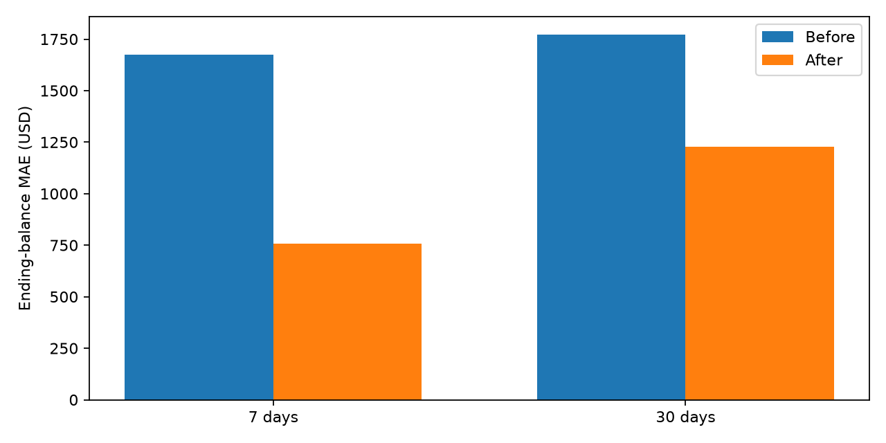
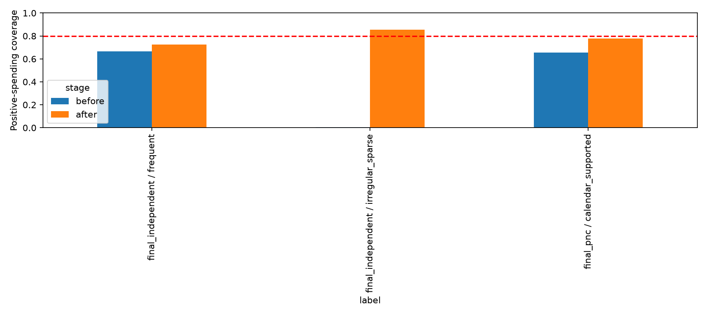

# FinPilot — Before / After Reliability Evaluation

Completed November 7, 2026 (America/Chicago). This report compares executed code and
artifacts. It does not claim real-world accuracy. The original audit and outputs
are preserved under [reports/reliability/before](reports/reliability/before/).
The original PNC transactions and all three trained model files have unchanged
SHA-256 hashes, verified by the report generator. See [manifest.json](reports/reliability/manifest.json).

## Decision summary

| Priority | Outcome |
|---|---|
| Three accounting failures | Fixed; the three former strict xfails are ordinary passing regression tests |
| Cash projection | Improved on the same 90 synthetic customer/origin pairs; residual errors remain substantial |
| Cold start | No zero-padding before earliest observation; explicit limited-history estimate or abstention |
| Guardian | Better precision/recall through corrected cash inputs; unchanged thresholds; still misses most $2000 breaches |
| New-profile generalization | Independently generated cohorts tested; no consistent superiority over a strong rolling baseline |
| Positive-spend intervals | Improved separate-calibration coverage, with measurable width costs; nominal 80% not universally achieved |

## 1. Accounting fixes

Executed before: `pytest ... --runxfail -k "internal_transfer or generic_card or matching_card"`
reproduced **3 failures**: a $300 transfer counted as spending; a $100 card purchase
entered checking-spending history; and a $35 obligation was reported as $70.
After: **all three pass**, with xfail decorators removed.

- `app/calc/metrics.py`: transfers, refunds and repayments are not consumption or
  earned inflows. Category totals match the same expense definition. Card purchases
  remain consumption once, while repayments do not become a second expense.
- `checking_variable_transactions` is shared by both forecast adapters: only checking
  variable outflows enter the checking-spending history; card payment bills are
  separate future cash obligations.
- `Bill.liability_account_id` optionally identifies the repaid liability. Linked
  bills replace, rather than add to, that liability's minimum payment. Distinct linked
  debts remain additive. Invalid/foreign links are rejected.
- Legacy unlinked bills cannot be uniquely matched. Their total is compared with
  unmatched minimums using `max`, an explicitly warned **aggregate floor**, rather
  than blindly summing duplicate observations. This fixes duplicate reporting but
  does not infer missing debt relationships. Exact attribution requires links.
- PostgreSQL schema has an additive nullable FK migration. Existing rows remain
  readable through a JSON-key projection; linked writes require the migration.
  No live PostgreSQL migration was run or verified in this workspace.

## 2. Why small spending errors produced large cash errors

Diagnostic ranked hypotheses were card settlement, income schedules, bill timing,
and missing cash-management transfers. Oracle replacements below are **attribution
only**: they deliberately insert future actual components one at a time and are
never used as production features or claimed deployable accuracy.

| horizon | stage | ending_AE | path_MAE |
|---|---|---|---|
| 7.0000 | before | 1673.4241 | 808.7165 |
| 7.0000 | oracle_bills | 4.7343 | 1.3527 |
| 7.0000 | oracle_external | 4.7343 | 1.3527 |
| 7.0000 | oracle_income | 1361.5496 | 584.0422 |
| 7.0000 | oracle_other | 0.0000 | 0.0000 |
| 7.0000 | oracle_variable | 1361.5496 | 584.0422 |
| 30.0000 | before | 1770.6401 | 1454.3288 |
| 30.0000 | oracle_bills | 1974.4336 | 1068.1318 |
| 30.0000 | oracle_external | 4.7371 | 3.9457 |
| 30.0000 | oracle_income | 2019.6843 | 1409.1704 |
| 30.0000 | oracle_other | 0.0043 | 0.0004 |
| 30.0000 | oracle_variable | 2002.0909 | 1404.5312 |

The sequence replaces variable outflows, then income, then bills, external movements
and remaining movements. It is order-dependent and not an additive causal percentage
decomposition. Near-zero final residual validates reconciliation of the replay.
Large bill-timing errors dominate the 7-day examples; synthetic external funding/
withdrawals are a major remaining 30-day component. Accurate consumption does not
predict settlement dates or external money movement.

The initial settlement/schedule-only trial actually worsened 30-day ending MAE
from $1770.64 to $2421.52. That failure prompted the predeclared missing-transfer
probe; it is not hidden as an improvement. Adding **past-observed recurrence**,
not future actual transfers, produced the final result below. Historical final
replay was reused for debugging, so it is not a new blind performance trial.

Production PNC assumptions now use `ledger_projection.py::ledger_assumptions`:
origin-only 90-day history, separate median amounts for each payday, separate
category/due-day bill estimates, and a checking-paid fraction of consumption.
Monthly income is no longer rolling-90-day receipts divided by three and then
split equally. Month-end dates are normalized to day 31 with calendar clamping.
External cash movements repeated in at least two observed months have a separate
signed schedule; they are not income or spending. They are **inferred**, not known
bank instructions, and may fail to recur. Unknown/unpredictable transfers remain
an important limitation. Tests assert future rows cannot change these assumptions.

Same final dates and customers, 3 non-overlapping 30-day origins per customer:

| horizon | before_path_MAE | after_path_MAE | before_ending_MAE | after_ending_MAE | ending_MAE_improvement | improvement_cluster_95_CI |
|---|---|---|---|---|---|---|
| 7.0000 | 808.7165 | 417.6207 | 1673.4241 | 758.6692 | 914.7549 | [574.0352, 1260.3771] |
| 30.0000 | 1454.3288 | 1006.3706 | 1770.6401 | 1226.0813 | 544.5588 | [149.8127, 976.4667] |

Intervals are paired **customer-cluster bootstrap** 95% intervals, 2500 resamples,
seed 42. Positive improvement means lower error. This measures uncertainty within
one synthetic generator, not real-world confidence. Compare the intervals to zero
before calling an improvement statistically established. Even the improved 30-day
ending error exceeds $1200 on average, so it is not practically reliable for
precise cash promises. This is the PNC legacy cash path; the Nessie route uses
explicit backend schedules and does not inherit a validated historical accuracy
claim from this replay.

## 3. Cold-start safety

For the same one-day, $20 observed-spending fixture:

| Quantity | Before | After |
|---|---:|---:|
| 30-day variable spending | $6.16 | $600.00 |
| Ending checking | $4893.84 | $4300.00 |

This is **not** improved prediction accuracy against a ground truth. The old result
silently treated the preceding missing days as zero; the new result repeats the
observed-day mean as an explicitly uncertain planning assumption. Fewer than 29
days receives `status=limited_history`, a visible warning, a Guardian uncertainty
notice and wide uncalibrated stress bounds. Empty history, or short history with
no observed cash spending, yields `status=abstained`, an empty path and no invented
future balance. The frontend suppresses forecast numbers for abstention. Tool
results carry status/warnings. Actual current low balances still trigger an alert.
History coverage is inferred from the earliest supplied transaction; ingestion
does not yet distinguish every missing day from a genuinely observed zero day.

## 4. Guardian: genuine labeled outcomes and no final-set threshold tuning

Labels are original synthetic end-of-day checking balances. Buffer thresholds
500/1000/2000 were fixed before this work. Candidate extra margins were selected
only on April–June development origins using F1 with precision >=50%; the selected
margin was **zero**. No sensitivity knob or final-test threshold was deployed.
Improvements below come from cash-flow correctness, not tuned final alerts:

| horizon | policy | TP | FP | FN | TN | precision | recall | F1 |
|---|---|---|---|---|---|---|---|---|
| 7.0000 | before | 0.0000 | 3.0000 | 0.0000 | 87.0000 | 0.0000 | N/A | 0.0000 |
| 7.0000 | after_point | 0.0000 | 0.0000 | 0.0000 | 90.0000 | N/A | N/A | 0.0000 |
| 30.0000 | before | 3.0000 | 4.0000 | 8.0000 | 75.0000 | 0.4286 | 0.2727 | 0.3333 |
| 30.0000 | after_point | 4.0000 | 1.0000 | 7.0000 | 78.0000 | 0.8000 | 0.3636 | 0.5000 |

At 30 days/$2000, recall rises from 3/11 to 4/11, precision from 3/7 to 4/5.
The customer-cluster 95% interval for recall change is **[-0.7142857142857143, 0.7]**. One additional
detected event is encouraging, but this tiny positive sample does not establish
robust risk detection. Seven breaches are still missed. Default $500-buffer
recall remains undefined because this synthetic replay has no observed positives.
All thresholds and false alarms are in `guardian_before_after.csv`.
Native backend Guardian additionally warns on limited/absent history; uncertainty
is not represented as a falsely precise safe balance.

## 5. Generalization on independently generated financial profiles

Frozen models, no retraining or final-label model selection. A new generator uses
heterogeneous Bernoulli purchase occurrence, lognormal purchase sizes, weekend
effects and modest drift rather than PNC's fixed posting dates. Calibration seed
20261001 and final seed 20261002 generate disjoint 60-profile cohorts, each with
180 history days and 30 future days. Synthetic future labels come from the declared
generator, not claimed observed customer outcomes. PNC final records are unchanged.

| cohort | model | n | MAE | RMSE | WAPE_pct |
|---|---|---|---|---|---|
| final_independent | serving | 1800.0000 | 37.0673 | 69.9317 | 99.2028 |
| final_independent | lightgbm | 1800.0000 | 39.8125 | 84.3662 | 106.5496 |
| final_independent | calendar_average | 1800.0000 | 44.0030 | 75.4806 | 117.7646 |
| final_independent | rolling_30 | 1800.0000 | 40.6520 | 66.2720 | 108.7963 |
| final_independent | previous_week | 1800.0000 | 50.5382 | 95.5941 | 135.2547 |
| final_pnc | serving | 540.0000 | 2.8886 | 9.0547 | 3.1468 |
| final_pnc | lightgbm | 540.0000 | 2.8886 | 9.0547 | 3.1468 |
| final_pnc | calendar_average | 540.0000 | 2.6563 | 9.9402 | 2.8938 |
| final_pnc | rolling_30 | 540.0000 | 128.3421 | 285.5897 | 139.8147 |
| final_pnc | previous_week | 540.0000 | 98.5377 | 248.3976 | 107.3461 |

The independent cohort's MAE is much larger than PNC's easy calendar task.
The existing frequency-based fallback improves serving MAE versus forcing LightGBM;
its point-selection policy was not changed during this work. On the final independent
cohort, LightGBM minus calendar MAE has cluster 95% CI [-7.15, -0.87] dollars, but
LightGBM minus rolling-average MAE has CI [-4.16, 2.93], including zero. Thus there
is evidence against the calendar baseline for this generator, but not superiority
over the rolling baseline. On the 30-day PNC unseen-customer replay, LightGBM still
loses to calendar average ($2.89 vs $2.66); the difference CI includes zero with
only six customers. The original 106-day one-step result ($3.04 vs $2.81) is retained
as historical evidence, not replaced by these different-horizon numbers.

Underlying causes: shared PNC date templates, no customer identity/scale embedding,
no actual category features, fixed payday proxy and quantile-median optimization.
Point-model redesign was deliberately not rushed into production. A representative
dataset and validation-based per-regime champion policy remain needed.
Summing daily medians is also not an expected monthly spending total; low daily
MAE alone cannot establish an unbiased cumulative cash forecast.

## 6. Separate positive-spending interval calibration

Fitted on held-out PNC customers in April–June only, plus the independent calibration
cohort. No original final dates or independent final labels enter quantile fitting.
The policy file is written **before** final predictions are generated and is bound
to exact model hashes. The point forecast is unchanged. The initial one-sided
prototype was replaced with the standard two-sided residual formulation using
calibration residuals; do not describe repeated retrospective final checks as a
brand-new blind benchmark.

Groups are chosen from observed history only: supported calendar patterns,
irregular sparse spending, or frequent spending. Scale is observed positive-spend
median. Fit the fixed 80th percentile of positive calibration nonconformity
`max(lower-y, y-upper)/scale`, expanding both sides and clipping spending at zero.
This is an **empirical positive-spending calibration**, not a claim of rigorous
conditional conformal guarantees: observations within customers are dependent.
No 90% interval implementation or cash-interval calibration is claimed.
Residual adjustment is restricted to the first 30 days. Days 31–90 retain raw,
uncalibrated bounds and emit an explicit warning; there is no unsupported horizon
extrapolation of calibration.
The adjustment also requires at least 90 supplied history days; it is not applied
to cold-start or short-history profiles.

| cohort | group | stage | n | coverage | width |
|---|---|---|---|---|---|
| final_independent | frequent | before | 545.0000 | 0.6642 | 120.1724 |
| final_independent | frequent | after | 545.0000 | 0.7266 | 133.7907 |
| final_independent | irregular_sparse | before | 171.0000 | 0.0058 | 1.5998 |
| final_independent | irregular_sparse | after | 171.0000 | 0.8538 | 150.4521 |
| final_pnc | calendar_supported | before | 90.0000 | 0.6556 | 72.3356 |
| final_pnc | calendar_supported | after | 90.0000 | 0.7778 | 80.4833 |

| cohort | group | positive_coverage_gain | cluster_95_CI |
|---|---|---|---|
| final_independent | frequent | 0.0624 | [0.04218656397090287, 0.08716972094884003] |
| final_independent | irregular_sparse | 0.8480 | [0.791907514450867, 0.9006622516556292] |
| final_pnc | calendar_supported | 0.1222 | [0.044444444444444446, 0.2111111111111111] |

Positive coverage improves substantially, especially for irregular sparse histories,
but the width cost is material. Frequent-spending final coverage remains about
73%, below the 80% goal. On a zero-heavy target, covering zero plus 80% of positives
necessarily gives overall coverage above 80% (at 83% zeros, about 96.6%). Therefore
we do not label these as universally calibrated 80% intervals. Full overall coverage
and widths are in `interval_before_after.csv`; accumulated cash bounds remain
uncalibrated stress envelopes. The policy needs external validation before use
with real customer data or different generators.

Additional frozen-policy confirmation, seed **20261003**, 60 new profiles and no
parameter fitting or changes to earlier final records:

| group | stage | positive_n | positive_coverage | positive_width |
|---|---|---|---|---|
| frequent | before | 570.0000 | 0.6333 | 121.4419 |
| frequent | after | 570.0000 | 0.6877 | 136.8205 |
| irregular_sparse | before | 177.0000 | 0.0113 | 2.0645 |
| irregular_sparse | after | 177.0000 | 0.8305 | 152.2572 |

| model | MAE |
|---|---|
| lightgbm | 46.0071 |
| serving | 41.1568 |
| calendar_average | 50.6079 |
| rolling_30 | 45.4093 |
| previous_week | 53.8747 |

This cohort was generated only after freezing the policy. The confirmation
manifest hashes the unchanged calibration policy and checks interval parity
against production inference. The frequent-spending 80% target is still missed;
no final/confirmation-set retuning was performed to hide that failure. These
are additional synthetic observations from one generator family, not real users.

## Production change inventory

| Files | Behavior / compatibility |
|---|---|
| `backend/app/calc/metrics.py` | Shared cash-spending filter; non-consumption exclusions; liability-linked debt attribution |
| `backend/app/calc/models.py`, `db/schema.sql`, `db/postgres.py` | Optional bill/liability link; additive migration; legacy read compatibility |
| `backend/app/data/nessie.py` | Accept and validate optional schedule/liability links against imported liabilities |
| `backend/intelligence/backend_adapter.py` | Cash-basis history/health, debt-ambiguity warning, limited-history Guardian notice |
| `backend/app/baseline/forecast.py` | Observed history window, limited-history assumptions, no-history abstention; cent reconciliation retained |
| `backend/app/schemas/forecast.py` | Additive `status` field; ordinary existing forecasts remain `estimated` |
| `backend/app/services/gateway.py`, `services/health.py`, `services/guardian.py`, `services/dashboard.py` | Preserve fallback/health warnings in forecast/dashboard; disclose debt ambiguity in all modes |
| `backend/app/baseline/guardian.py`, `tools/registry.py` | Current-balance/uncertainty alerts and tool status propagation |
| `backend/intelligence/ledger_projection.py`, `data.py`, `forecasting.py` | Origin-only settlement, income/bill and cash-movement assumptions; no future labels |
| `backend/intelligence/validation.py`, `simulator.py` | Validate new signed movement/schedule inputs; apply income shocks to explicit payday schedules |
| `backend/intelligence/intervals.py`, `interval_calibration.json` | Posthoc positive-spend residual bands; model-hash binding; no point weights changed |
| `frontend/src/api.ts`, `ConnectedDashboard.tsx` | Render abstention honestly; no invented ending balance |
| `frontend/vite.config.ts`, `playwright.config.ts` | Optional separate local test ports; normal defaults unchanged |

Trained targets, input feature schema, splits, final labels, model weights and
point selection were unchanged. Existing original calendar-model limitations remain.
Source dataset and model hashes are checked at report generation. No bank writes,
transactions, external API requests or real credentials are needed for this evaluation.

## Verification and reproducibility

Executed Python suite: **182 passed, 1 skipped, 0 unexpected
failures**. The former three expected failures now pass normally. The skip is the
existing live PostgreSQL test; database migration compatibility is not live-verified.
The project check script and recursive backtest executed successfully. Frontend
TypeScript checking and production build passed. Four Edge browser tests passed,
including abstention display, API-backed values/horizons, errors and shortage
warnings. Browser checks used isolated demo servers on ports 8001/5174; normal
development ports remain 8000/5173. No live Nessie or LLM call was needed.

```powershell
.venv/Scripts/python.exe -m scripts.reliability_cash
.venv/Scripts/python.exe -m scripts.reliability_generalization
.venv/Scripts/python.exe -m scripts.confirm_reliability
.venv/Scripts/python.exe -m pytest -q --junitxml=reports/reliability/after_tests.xml
powershell -ExecutionPolicy Bypass -File scripts/check.ps1
.venv/Scripts/python.exe -m scripts.backtest
.venv/Scripts/python.exe -m scripts.report_reliability
cd frontend
npm.cmd run typecheck
npm.cmd run build
```

The baseline snapshot must remain immutable. Do not overwrite it when rerunning
after evaluations. All new raw predictions, labeled outcomes, fitted parameters,
statistical intervals and checks are under `reports/reliability/`. Real-world
accuracy and deployed Nessie risk precision/recall remain NOT EVALUATED.



