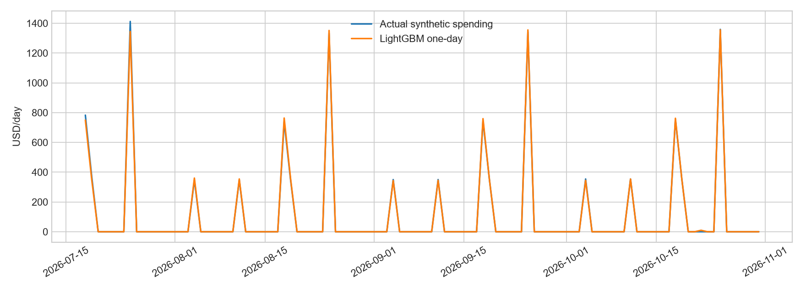
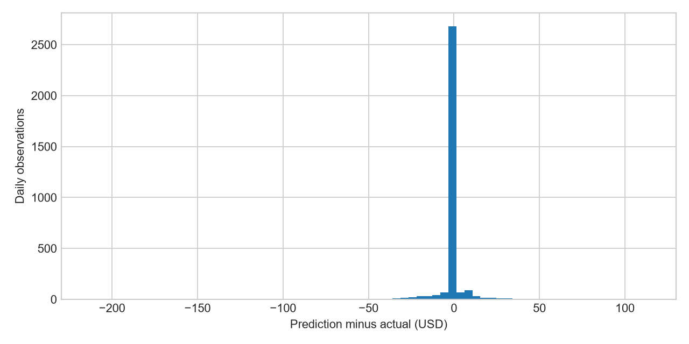
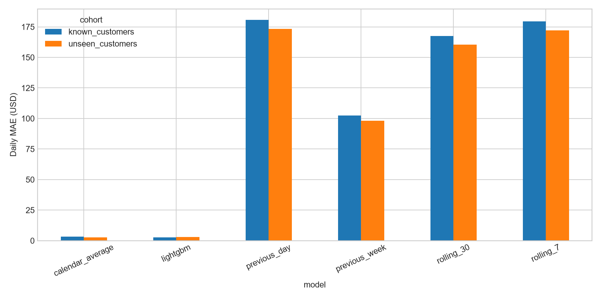
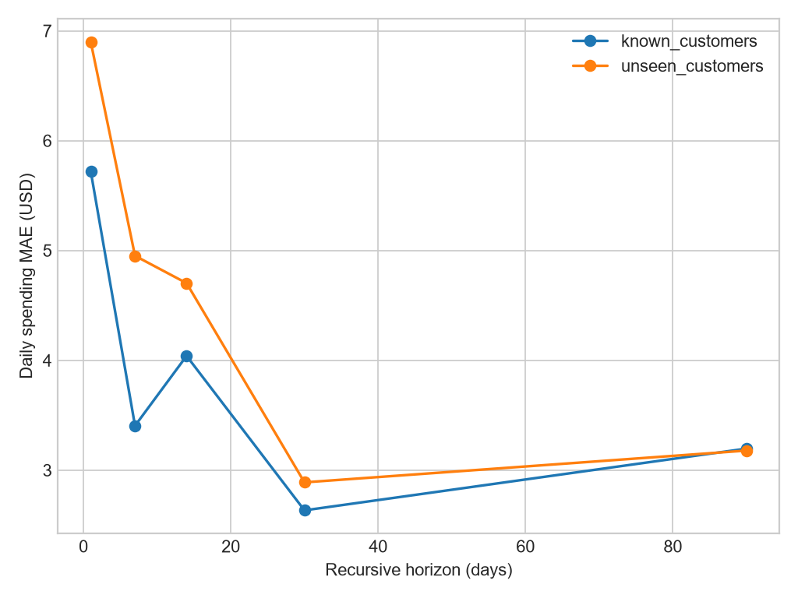
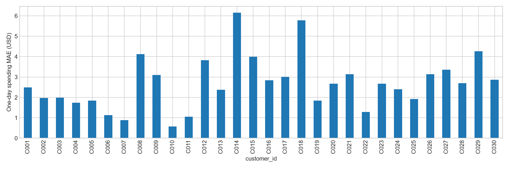
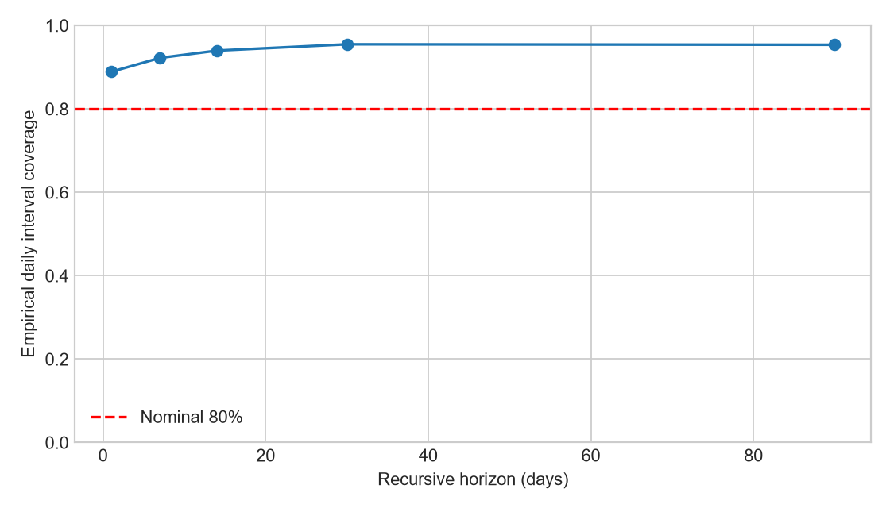
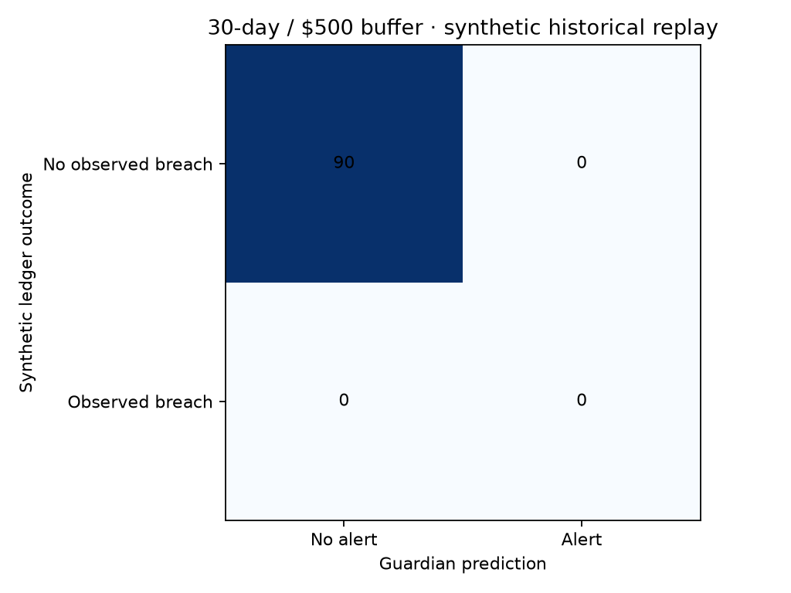

# FinPilot — MODEL_EVALUATION_REPORT

> Historical baseline audit. Reliability fixes and current verification are in
> [BEFORE_AFTER_EVALUATION.md](BEFORE_AFTER_EVALUATION.md). The immutable original
> report and evaluation artifacts are under `reports/reliability/before/`.

Evaluation date: November 7, 2026 (America/Chicago). This is an executed audit of the
existing artifacts, not a proposal. Financial data are synthetic except the separately
identified cached FRED research. No production model, feature set or selection policy
was changed. Historical test results were already visible before this audit; this is
a frozen-artifact re-evaluation, not an untouched final benchmark.

## Overall assessment

| Category | Status | Evidence |
|---|---|---|
| Known-customer one-day MAE beats strongest tested baseline | PASS | $2.6188 vs $3.3083; 20.84% improvement |
| Unseen-customer one-day MAE beats strongest tested baseline | FAIL | $3.0384 vs $2.8137; 7.99% worse |
| Direct future-target leakage in daily spending features | PASS | Shift-before-roll and future-mutation/customer-isolation tests |
| Quantile calibration | FAIL | Nominal 80% coverage is about 95%; positive-spending coverage is much lower |
| Financial stress arithmetic after rounding fix | PASS | Exact cent reconciliation and bounded/finite outputs in controlled scenarios |
| Complete accounting correctness | FAIL | Three strict expected-failure regression checks reproduce unresolved accounting gaps |
| Safe cold-start forecasting | FAIL | One observed day is zero-padded by fallback; severe spending understatement despite warning |
| Guardian reliable risk detection | FAIL | At 30 days/$2000 threshold, only 3 of 11 observed breaches detected |
| Guardian recall at default $500 buffer | NOT EVALUATED | No positive observed breaches in this replay at that threshold |
| Real-world spending/balance accuracy | NOT EVALUATED | No representative real customer banking test set |
| Economic/market predictive advantage | FAIL | Reproduced research does not beat its baseline gates |
| Hackathon demonstration | PASS | Runnable synthetic prototype with explicit limitations; not production readiness |

## Actual model architecture and dependencies

`backend/intelligence/training.py::train` fits **three LightGBM quantile regressors**
at alpha 0.1, 0.5 and 0.9. Target: aggregate daily variable consumption in USD,
not transactions, savings, stock prices or account balance. Maximum 400 trees,
learning rate .04, 23 leaves, minimum 40 child samples, seed 42, 2 training threads,
35-round validation early stopping. Actual saved tree counts: `{'lower': 400, 'median': 400, 'upper': 398}`.
The three saved artifacts are lower/median/upper versions of one target, not
three separate forecast-horizon models. Serving sorts nonnegative quantiles;
its point is the middle sorted output, which can differ from the raw median
regressor when quantiles cross.

`features.py::make_features` uses these 12 fields: `weekday, day, month, payday_distance, lag_1, lag_7, lag_28, mean_7, mean_28, std_28, calendar_lag_1, calendar_mean_3`.
All spending lags/statistics use earlier dates. Calendar features use prior
calendar months; zero days are included. **There are no explicit category features**
and `payday_distance` is a fixed 1/15/28 calendar proxy, not the customer's actual
pay schedule. Income, debt and emergency expenses are not ML input targets.

`forecasting.py::forecast_spending` recursively feeds previous predictions into
subsequent features. It requires 29 contiguous days; at >=90 days a heuristic
zero-day-frequency check can replace ML with a moving average. Missing artifacts
also use a baseline. This is calculated fallback behavior, not hardcoded future
balances. The current Nessie demo is known to trigger the fallback, so its UI
does not establish LightGBM performance. `backend_adapter.py::forecast_profile`
routes spending into `_project`, using `app/calc/projection.py::project_balance`
for Decimal schedule arithmetic. `app/services/gateway.py::Gateway.run` supplies
a warned weekday-average fallback when the intelligence layer rejects input.
Scoring/Guardian/simulations are deterministic heuristics, not trained classifiers.

Additional models: `economic_outlook.py::research_outlook` transiently fits two
StandardScaler+Ridge(alpha=10) regressions (next-month inflation and unemployment)
and a StandardScaler+LogisticRegression(C=.1) classifier (next-month positive S&P
500 price return). They are research-only fits, not deployed persisted model files.
The economy/market condition labels in `conditions.py` are threshold rules, not ML.

## Dataset and splits

Existing PNC data: **21,225 ledger rows**, **21,900
daily rows**, **21,060 usable feature rows**, 30 customers,
2024-11-01 through 2026-10-31. Daily target zero fraction: 83.01%.
Training rows: 11,784; training ends before 2026-04-04.
Validation: 2026-04-04 through 2026-07-17 (2520 known-customer rows).
Chronological test: 2026-07-18 through 2026-10-31: 2544 known-customer and
636 unseen-customer rows. Held out of fitting/selection: C025, C026, C027, C028, C029, C030.
Scalers are not used in LightGBM preprocessing. Macro scalers fit inside each
training fold. Hashes, runtime versions and counts are in [summary.json](reports/ml_evaluation/summary.json).
Saved-model hashes remained unchanged. The loader and hashes do not cryptographically
prove which historical data originally produced the files; split counts come from
the existing training code/metadata and are reproducible from the current dataset.
Source-ledger integrity checks found 0
account-balance continuity violations and
0 net-wealth conservation
violations across 4110 internal transfer pairs.
Those checks use integer cents and liability-aware signs. They establish internal
consistency of the source generator, not completeness of application accounting.

## Leakage and validity audit

| Check | Finding | Severity |
|---|---|---|
| Random time-series split | None in spending training; date cutoffs and separate customers | Low |
| Future spending in features | Not found; shifted lags/rolling/calendar offsets | Low |
| Target in current row | Not found; future/current-target mutation test preserves earlier features | Low |
| Global fitted preprocessing | None in spending; macro scalers fit only training folds | Low |
| Duplicate samples | Source has 0 identical rows and 0 duplicated transaction IDs; source loader does not reject future duplicate input | Medium |
| Customer leakage | Held-out IDs excluded from training and early stopping; no customer-ID feature | Low |
| Overlapping windows | One-day features legitimately use earlier test observations; not equivalent to fixed-origin recursion | Medium |
| Synthetic shortcuts | Same recurring posting dates and near-fixed customer/category proportions | High |
| Historical account snapshots | Replay uses origin ledger balances; never current account snapshots as historical features | Low |
| FRED vintage leakage | Current-revised cache can include revisions unavailable at past origins; two-month lags do not solve this | High |

`vendor/pnc-utd-hackathon-2026/Lab_Package/generate_history.py` posts direct expenses
on days 3/10/18/25, card consumption on 4/11/19/25, and payroll on 1/15, with small
monthly variations. It calibrates balances using artificial external cash-management
transfers. Thus calendar models solve an unusually easy schedule-recognition task.
High R² and zero median error do not demonstrate real-world robustness. No direct
spending-label leakage was found to fix. Macro vintage contamination cannot be
repaired honestly without point-in-time/vintage data; no replacement data were invented.

## One-day accuracy and baseline comparison

All methods use identical target rows, with true prior days available. The calendar
baseline averages the same day in the previous three calendar months, falling back
to the prior 28-day mean. This is stronger than the older single-month baseline
in the model card. The strongest baseline is selected descriptively for this table;
it does not change serving selection or tune on these labels.

| cohort | model | MAE | RMSE | WAPE_pct | improvement_vs_best_baseline_pct |
|---|---|---|---|---|---|
| known_customers | previous_day | 180.5734 | 419.9697 | 176.3622 | -5358.2381 |
| known_customers | previous_week | 102.4743 | 284.9943 | 100.0844 | -2997.5156 |
| known_customers | rolling_7 | 179.3487 | 304.3317 | 175.1660 | -5321.2176 |
| known_customers | rolling_30 | 167.5305 | 297.8197 | 163.6235 | -4963.9874 |
| known_customers | calendar_average | 3.3083 | 12.2183 | 3.2311 | 0.0000 |
| known_customers | lightgbm | 2.6188 | 10.1733 | 2.5577 | 20.8418 |
| unseen_customers | previous_day | 173.2726 | 428.9279 | 176.3830 | -6058.2551 |
| unseen_customers | previous_week | 98.1539 | 289.7734 | 99.9159 | -3388.4749 |
| unseen_customers | rolling_7 | 172.0625 | 310.7887 | 175.1512 | -6015.2495 |
| unseen_customers | rolling_30 | 160.5401 | 304.0839 | 163.4219 | -5605.7303 |
| unseen_customers | calendar_average | 2.8137 | 10.2277 | 2.8642 | 0.0000 |
| unseen_customers | lightgbm | 3.0384 | 9.1997 | 3.0930 | -7.9885 |

All requested regression metrics for LightGBM:

| cohort | n | MAE | RMSE | WAPE_pct | sMAPE_pct | R2 | bias | median_AE | p90_AE | p95_AE |
|---|---|---|---|---|---|---|---|---|---|---|
| known_customers | 2544.0000 | 2.6188 | 10.1733 | 2.5577 | 2.3415 | 0.9988 | -0.3258 | 0.0000 | 7.8946 | 16.2246 |
| unseen_customers | 636.0000 | 3.0384 | 9.1997 | 3.0930 | 2.5299 | 0.9991 | -1.2750 | 0.0000 | 11.2844 | 21.9329 |

On **positive-spending days only**, MAE is $14.88 for known
and $17.36 for unseen customers. Many zero days hide this
larger conditional error.

Metric meanings: MAE is average absolute dollar error; RMSE penalizes big misses more;
WAPE divides total absolute error by total actual spending; sMAPE averages symmetric
percentage error (zero/zero defined as zero); R² measures variance explained and can
be negative; bias is prediction minus actual (negative means underprediction).
Median/p90/p95 absolute errors describe typical and tail misses. WAPE is undefined
when actual total is zero; percentage metrics can mislead on sparse spending.

## Recursive horizons and expanding walk-forward evaluation

For each customer, origins are 2026-07-17, 2026-08-16 and 2026-09-15. Thirty-day
blocks do not overlap within a customer. Horizons 1/7/14/30 use the same origins;
90-day forecasts use only July 17. Horizons overlap each other and customers share
synthetic generation rules, so samples are not independent. Every method recursively
uses its **own predictions**, with no actual future spending supplied. The optimized
evaluation implementation exactly matched production's rounded 90-day path for C001.

| cohort | horizon | origins | daily_MAE | daily_RMSE | WAPE_pct | ending_balance_MAE_conditional |
|---|---|---|---|---|---|---|
| known_customers | 1.0000 | 72.0000 | 5.7175 | 13.1458 | 2.5006 | 5.7175 |
| known_customers | 7.0000 | 72.0000 | 3.4039 | 8.6609 | 2.3713 | 22.8483 |
| known_customers | 14.0000 | 72.0000 | 4.0400 | 13.8291 | 2.5278 | 54.4003 |
| known_customers | 30.0000 | 72.0000 | 2.6337 | 10.1240 | 2.7456 | 52.9483 |
| known_customers | 90.0000 | 24.0000 | 3.1960 | 13.0325 | 3.3318 | 182.4696 |
| unseen_customers | 1.0000 | 18.0000 | 6.8972 | 13.8697 | 3.1940 | 6.8972 |
| unseen_customers | 7.0000 | 18.0000 | 4.9513 | 11.1365 | 3.6114 | 34.2506 |
| unseen_customers | 14.0000 | 18.0000 | 4.7024 | 12.4167 | 3.0805 | 63.3167 |
| unseen_customers | 30.0000 | 18.0000 | 2.8886 | 9.0547 | 3.1468 | 64.1800 |
| unseen_customers | 90.0000 | 6.0000 | 3.1779 | 10.6474 | 3.4620 | 169.7783 |

Conditional ending-balance error here is negative cumulative spending error assuming
identical perfectly known income/bills for model and truth. It isolates spending
error; it is **not** measured bank-balance accuracy. Daily MAE need not increase
monotonically with horizon because the calendar mix changes. Cumulative dollar
errors usually grow. All six methods and all nine requested regression metrics
are in `horizon_metrics.csv` and `recursive_origin_metrics.csv`.

Separate expanding-window refits of the median model used the original fixed
hyperparameters, a 30-day validation block, a following 30-day test block and known
customers only. Production artifacts and serving selection were untouched:

| test_start | train_rows | validation_rows | model | n | MAE | RMSE |
|---|---|---|---|---|---|---|
| 2025-12-20 | 8544.0000 | 720.0000 | lightgbm_median | 720.0000 | 4.8985 | 34.1682 |
| 2025-12-20 | 8544.0000 | 720.0000 | calendar_average | 720.0000 | 7.3657 | 27.1390 |
| 2026-04-04 | 11064.0000 | 720.0000 | lightgbm_median | 720.0000 | 3.3079 | 19.4038 |
| 2026-04-04 | 11064.0000 | 720.0000 | calendar_average | 720.0000 | 3.4894 | 12.3018 |
| 2026-07-18 | 13584.0000 | 720.0000 | lightgbm_median | 720.0000 | 2.7505 | 10.6412 |
| 2026-07-18 | 13584.0000 | 720.0000 | calendar_average | 720.0000 | 3.4676 | 13.3192 |

## Historical account-balance accuracy — separate from consumption

`scripts/evaluate_cash_replay.py` reconstructs each origin's checking and savings
from the existing ledger, estimates schedules from the **preceding 90 days**, and
calls the actual legacy `project_cash` and Guardian functions. No future balances
or transactions enter assumptions. Labels are actual synthetic **end-of-day checking
balance_after**, forward-filled only after observed past balances. One checking
account per customer is asserted. Future external balancing transfers are unknown
to the forecast. Monthly inferred income/bills, cash/card timing and synthetic
external funding make this a demanding but imperfect end-to-end replay.

| cohort | horizon | origins | balance_path_MAE | ending_balance_MAE | ending_bias |
|---|---|---|---|---|---|
| known_customers | 1.0000 | 72.0000 | 5.7175 | 5.7175 | 3.5872 |
| known_customers | 7.0000 | 72.0000 | 822.7098 | 1701.5456 | -1701.5456 |
| known_customers | 14.0000 | 72.0000 | 1123.6688 | 1002.0494 | 39.1083 |
| known_customers | 30.0000 | 72.0000 | 1497.5169 | 1819.6944 | 139.7050 |
| known_customers | 90.0000 | 24.0000 | 3169.3723 | 5297.7600 | 460.6850 |
| unseen_customers | 1.0000 | 18.0000 | 6.8972 | 6.8972 | 4.5717 |
| unseen_customers | 7.0000 | 18.0000 | 752.7432 | 1560.9383 | -1560.9383 |
| unseen_customers | 14.0000 | 18.0000 | 1011.8060 | 693.3678 | -153.6033 |
| unseen_customers | 30.0000 | 18.0000 | 1281.5779 | 1574.4228 | -361.3961 |
| unseen_customers | 90.0000 | 6.0000 | 2681.4559 | 4403.4800 | -1010.9667 |

The thousands-of-dollars cash errors are materially larger than consumption errors.
They show that good spending MAE does not establish a reliable account-balance
forecast. This replay evaluates the legacy PNC dictionary projection, not historical
Nessie accuracy; Nessie has insufficient longitudinal labeled snapshots. The current
FastAPI Decimal scheduler is tested for arithmetic separately. Intraday balance
minima are not evaluated.

## Controlled stress tests

These are synthetic input interventions, not invented labeled outcomes. A/B/C/E/F/I
primarily test deterministic cash arithmetic; D applies a hypothetical future surge;
D2/G/J challenge input history; H supplies explicit irregular-income assumptions,
not a model of income uncertainty. Base variable outflow is $20/day. C raises the
essential half by 20% and essential bills by 20%. No real accuracy metric is assigned
to any controlled scenario.

| case | spending_total | projected_min | ending_balance | ending_change | health_score | health_change | invariants_pass |
|---|---|---|---|---|---|---|---|
| BASE | 600.0000 | 500.0000 | 4300.0000 | 0.0000 | 76.9800 | 0.0000 | True |
| A_income_minus_30pct | 600.0000 | 500.0000 | 3040.0000 | -1260.0000 | 76.9800 | 0.0000 | True |
| B_emergency_1500 | 600.0000 | -1000.0000 | 2800.0000 | -1500.0000 | 65.4800 | -11.5000 | True |
| C_essential_cost_plus_20pct | 660.0000 | 140.0000 | 3900.0000 | -400.0000 | 76.1600 | -0.8200 | True |
| D_discretionary_surge_week | 1300.0000 | -200.0000 | 3600.0000 | -700.0000 | 76.9800 | 0.0000 | True |
| D2_observed_recent_surge | 1184.3500 | 352.8700 | 3715.6500 | -584.3500 | 76.1400 | -0.8400 | True |
| E_delayed_paycheck | 600.0000 | 100.0000 | 100.0000 | -4200.0000 | 76.9800 | 0.0000 | True |
| F_clustered_bills | 600.0000 | 500.0000 | 4300.0000 | 0.0000 | 76.9800 | 0.0000 | True |
| G_one_history_day | 6.1600 | 698.4600 | 4893.8400 | 593.8400 | 79.1400 | 2.1600 | True |
| H_irregular_income_assumption | 600.0000 | 680.0000 | 3100.0000 | -1200.0000 | 76.9800 | 0.0000 | True |
| I_high_debt | 600.0000 | -2000.0000 | 1800.0000 | -2500.0000 | 22.9500 | -54.0300 | True |
| J_zero_refund_transfer | 9.6700 | 700.0000 | 4890.3300 | 590.3300 | 79.2400 | 2.2600 | True |

Detailed rule IDs, warnings and classification are in `stress_results.json`.
The $1500 emergency reduces ending cash exactly $1500; a 30% reduction in two
$2100 paychecks reduces it $1260. The $700 surge reduces cash $700. A delayed pay
schedule removes $4200 in this horizon. All outputs remained finite and scores
bounded. However, one history day produces only about $6 forecast spending over
30 days because the backend fallback pads unobserved days with zeros. **Arithmetic
PASS does not mean cold-start safety PASS.** The score is unchanged after the
paycheck delay despite materially worse liquidity; it does not fully model timing.
Zero-history inputs can still produce positive periodic ML estimates; the support
heuristic primarily detects unusually frequent spending, not every type of shift.

## Uncertainty calibration

Only the existing .1/.9 quantile pair is available, nominally 80%. A genuine 90%
interval needs .05/.95 models or a separate calibration procedure; 90% coverage
is **NOT EVALUATED**, not inferred or fabricated. Bounds are sorted/clipped in
serving. Raw quantiles cross on 47 of 3180
rows; served negative predictions and inverted bounds count zero.

| cohort | n | coverage_80 | width_USD |
|---|---|---|---|
| known_customers | 2544.0000 | 0.9568 | 11.2355 |
| unseen_customers | 636.0000 | 0.9450 | 13.6096 |

Recursive daily interval coverage by horizon:

| group | n | coverage_80 | width_USD |
|---|---|---|---|
| 1 | 90.0000 | 0.8889 | 22.1108 |
| 7 | 630.0000 | 0.9222 | 13.7498 |
| 14 | 1260.0000 | 0.9397 | 17.5310 |
| 30 | 2700.0000 | 0.9548 | 10.2520 |
| 90 | 2700.0000 | 0.9537 | 10.5903 |

Thirty-day recursive coverage by actual spending level (positive split uses the
test-set median solely for descriptive stratification):

| group | n | coverage_80 | width_USD |
|---|---|---|---|
| positive_high | 213.0000 | 0.6854 | 100.3745 |
| positive_low | 237.0000 | 0.7679 | 26.4404 |
| zero | 2250.0000 | 1.0000 | 0.0153 |

The aggregate overcoverage is dominated by zero-spending days. High-spending
days are undercovered relative to 80%. Calibration by profile is also provided
in `interval_calibration.csv` (30-day horizon only). Accumulated balance stress
envelopes have no nominal 80%/90% joint guarantee. A suitable next experiment is
calibration on a separate pre-test window, with spend/no-spend stratification and
horizon-specific block/conformal methods. Do not calibrate on this test set.

## Guardian labeled historical replay

Labels are derived from the existing synthetic ledger, not newly invented. A
positive means origin-inclusive end-of-day minimum below the threshold. These
are observed breaches, not causal labels for all Guardian rules. Precision is
TP/(TP+FP); recall TP/(TP+FN); F1 combines both. Undefined ratios are N/A.

| horizon | threshold | n | TP | TN | FP | FN | precision | recall | F1 | false_positive_rate | false_negative_rate |
|---|---|---|---|---|---|---|---|---|---|---|---|
| 1.0000 | 500.0000 | 90.0000 | 0.0000 | 90.0000 | 0.0000 | 0.0000 | N/A | N/A | N/A | 0.0000 | N/A |
| 1.0000 | 1000.0000 | 90.0000 | 0.0000 | 90.0000 | 0.0000 | 0.0000 | N/A | N/A | N/A | 0.0000 | N/A |
| 1.0000 | 2000.0000 | 90.0000 | 0.0000 | 90.0000 | 0.0000 | 0.0000 | N/A | N/A | N/A | 0.0000 | N/A |
| 7.0000 | 500.0000 | 90.0000 | 0.0000 | 90.0000 | 0.0000 | 0.0000 | N/A | N/A | N/A | 0.0000 | N/A |
| 7.0000 | 1000.0000 | 90.0000 | 0.0000 | 90.0000 | 0.0000 | 0.0000 | N/A | N/A | N/A | 0.0000 | N/A |
| 7.0000 | 2000.0000 | 90.0000 | 0.0000 | 87.0000 | 3.0000 | 0.0000 | 0.0000 | N/A | 0.0000 | 0.0333 | N/A |
| 14.0000 | 500.0000 | 90.0000 | 0.0000 | 90.0000 | 0.0000 | 0.0000 | N/A | N/A | N/A | 0.0000 | N/A |
| 14.0000 | 1000.0000 | 90.0000 | 0.0000 | 88.0000 | 2.0000 | 0.0000 | 0.0000 | N/A | 0.0000 | 0.0222 | N/A |
| 14.0000 | 2000.0000 | 90.0000 | 3.0000 | 79.0000 | 4.0000 | 4.0000 | 0.4286 | 0.4286 | 0.4286 | 0.0482 | 0.5714 |
| 30.0000 | 500.0000 | 90.0000 | 0.0000 | 90.0000 | 0.0000 | 0.0000 | N/A | N/A | N/A | 0.0000 | N/A |
| 30.0000 | 1000.0000 | 90.0000 | 0.0000 | 84.0000 | 6.0000 | 0.0000 | 0.0000 | N/A | 0.0000 | 0.0667 | N/A |
| 30.0000 | 2000.0000 | 90.0000 | 3.0000 | 75.0000 | 4.0000 | 8.0000 | 0.4286 | 0.2727 | 0.3333 | 0.0506 | 0.7273 |
| 90.0000 | 500.0000 | 30.0000 | 0.0000 | 24.0000 | 6.0000 | 0.0000 | 0.0000 | N/A | 0.0000 | 0.2000 | N/A |
| 90.0000 | 1000.0000 | 30.0000 | 0.0000 | 23.0000 | 7.0000 | 0.0000 | 0.0000 | N/A | 0.0000 | 0.2333 | N/A |
| 90.0000 | 2000.0000 | 30.0000 | 1.0000 | 19.0000 | 6.0000 | 4.0000 | 0.1429 | 0.2000 | 0.1667 | 0.2400 | 0.8000 |

At 30 days/$500 there are no observed positives, so recall and missed-risk rate
cannot be measured; 90 correct negatives are not proof of reliable risk detection.
At 30 days/$2000: precision 42.86%, recall 27.27%, F1 33.33%, false-negative rate
72.73%. Raising a buffer can identify earlier pressure but may alarm more users;
this synthetic replay cannot establish an optimal threshold. Synthetic funding
suppresses actual low-balance events. Scenario rule checks are separate from
historical precision/recall. No real-world Guardian reliability claim is supported.

## Economic model re-evaluation

Cached real FRED observations are evaluated separately; as-of 2026-10-31,
24 monthly evaluation outcomes, current-revised cache and unverified historical
publication vintages. These metrics do **not** validate a trading signal.

| target | model | n | MAE | RMSE | WAPE_pct | sMAPE_pct | R2 | bias | median_AE | p90_AE | p95_AE |
|---|---|---|---|---|---|---|---|---|---|---|---|
| next_inflation | ridge | 24.0000 | 0.5080 | 0.6621 | 17.5481 | 17.9810 | -1.1680 | -0.1954 | 0.3893 | 0.8788 | 0.9309 |
| next_inflation | persistence | 24.0000 | 0.4655 | 0.5628 | 16.0778 | 15.8989 | -0.5664 | 0.0099 | 0.4183 | 0.6571 | 0.7914 |
| next_unemployment | ridge | 24.0000 | 0.5698 | 0.6717 | 13.4992 | 13.5959 | -29.1121 | -0.0652 | 0.5038 | 0.9940 | 1.1993 |
| next_unemployment | persistence | 24.0000 | 0.1000 | 0.1354 | 2.3692 | 2.3756 | -0.2236 | -0.0083 | 0.1000 | 0.2000 | 0.2850 |

Units for absolute regression errors are percentage points, not dollars.
Market classifier balanced accuracy is 0.5000,
equal to its prior and momentum baselines. Brier score is
0.3016, worse than prior
0.2843. Native output correctly
abstains. Ridge MAEs reproduce native research outputs exactly; neither macro
regressor beats persistence. Point-in-time predictive validity remains NOT EVALUATED.

## Automated financial checks, fixes and unresolved issues

Executed full suite: **169 passed, 4 skipped/expected failures,
0 unexpected failures**. Three skips are strict expected failures
for known bugs; one is the existing live PostgreSQL integration skip. Exact
statuses are retained in [full_tests.xml](reports/ml_evaluation/full_tests.xml).
Expected failure is an audit **FAIL**, not a passed invariant.

`tests/ml_evaluation/test_pipeline.py` independently checks shifted features,
customer isolation, exact $2400 + $4200 - $1700 - $600 = $4300 reconciliation,
known bills once, fixed/transfer/refund exclusion from the variable target,
income/emergency direction and amounts, immutability, deterministic repeats,
short-history rejection, finite stress results and bounded scores.

One minimal production fix was made in
`backend/app/baseline/forecast.py::forecast`: quantize daily spending **before**
cash accumulation so exposed cent amounts reconcile. The reproduced cold-start
residual was $0.01; it is now zero. A separate fractional-cent regression checks
two $0.006 raw estimates become two $0.01 outflows and an ending balance of
$2399.98, not $2399.99. Training/targets/features were unchanged, so production
retraining was neither needed nor performed.

Unresolved, reproduced by strict xfails:

1. **High:** `app/calc/metrics.py::window_outflow` counts signed internal transfers
   as spending. Current Nessie importer filters them, but generic repository inputs
   are not protected by that boundary.
2. **High:** `backend_adapter.py::_history` includes variable-category purchases
   from every account. A generic card purchase can reduce checking forecasts while
   a future card-payment bill reduces it again. Nessie importer excludes card
   activity, so the scope of this failure is the generic input adapter.
3. **High:** `app/calc/metrics.py::monthly_debt_payments` sums account minimums and
   matching scheduled debt bills without deduplication. Reliable matching requires
   a liability/bill linkage; name-based guesses would introduce new errors.

Refunds are excluded from the gross-consumption target; they are not netted against
category spending, and generic positive refunds can inflate dashboard inflow. Cash
refund forecasting is not supported. Lack of a complete ledger movement model is
reported rather than concealed by rewriting accounting during this evaluation.

## Five prioritized recommendations

1. **Repair cash-flow normalization/accounting first:** distinguish consumption,
   repayments, refunds and transfers; bind bills to liabilities; backtest against
   origin-available schedules and ledger balances. Spending accuracy alone is insufficient.
2. **Add representative irregular synthetic histories and independent customer
   regimes**, with realistic transaction dates, missing-data markers and income
   timing. Keep a new untouched test set. Do not just tune to the existing generator.
3. **Use validation-based baseline selection per cohort/horizon**, particularly a
   strong calendar baseline, and explicit cold-start abstention/ranges instead of
   interpreting unobserved history as zero. Do not switch serving based on this test.
4. **Calibrate uncertainty on separate data**, stratifying zero/positive spending
   and horizons; evaluate cumulative cash intervals separately. Add calibrated
   90% intervals only after an actual implementation exists.
5. **Validate Guardian and macro models independently:** collect more labeled
   breach events, evaluate missed-risk costs, and use historical FRED vintages.
   Keep market-direction output in abstain mode and clearly label prototype limits.

## Reproduce and artifacts

```powershell
.venv/Scripts/python.exe -m pip install -r requirements-evaluation.txt
.venv/Scripts/python.exe -m scripts.evaluate_ml
.venv/Scripts/python.exe -m scripts.evaluate_cash_replay
.venv/Scripts/python.exe -m scripts.evaluate_macro_models
powershell -ExecutionPolicy Bypass -File scripts/check.ps1
.venv/Scripts/python.exe -m pytest -q --junitxml=reports/ml_evaluation/full_tests.xml
.venv/Scripts/python.exe -m scripts.report_ml_evaluation
```

Prerequisites: existing PNC CSVs and trained artifacts (bootstrap/train on a fresh
checkout), and the existing cached `data/economy/fred.csv` for macro evaluation.
The macro cache is ignored by Git; its hash/provenance are retained. No API keys,
Nessie calls or LLM calls are required. Missing resources fail explicitly; do not
substitute fabricated labels. Full numerical CSVs are under `reports/ml_evaluation/`.
The prior model card and training artifacts remain unchanged.

Charts:








