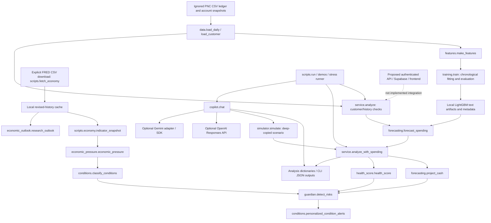

# FinPilot engineering audit

Audit date: **November 7, 2026 (America/Chicago)**. FinSight and ForeCastle are historical names; the implementation is named FinPilot.

Historical scope note: this audit describes the intelligence-only workspace before the later backend-mvp integration. See `TEAM_INTEGRATION.md` for the merged API and adapter verification. Findings below have not been retrospectively rewritten as fixed; backend integration alone does not resolve their financial/model concerns.

## 1. Scope, evidence, and verdict

This is an audit of the actual working directory, not an assessment based on the proposal. First-party source, scripts, tests, requirements, contracts, saved model metadata and generated examples were inspected. The relevant PNC ledger, its accounting helpers and upstream reconciliation tests were also inspected. Ignored upstream UI/agent examples are distinguished from active FinPilot functionality. This is not a line-by-line audit of every installed dependency, upstream notebook, or third-party demo, nor a vulnerability-database scan.

**Verdict: a functioning local intelligence prototype, with significant financial correctness and trust-boundary defects. It is not a production banking application or a validated financial prediction product.** It can demonstrate forecasting, rules, alerts and scenarios. Real bank ingestion, an active FinPilot API, authentication, persistent alert delivery, Supabase integration and a FinPilot frontend are absent. The upstream vendor checkout contains separate demo applications, but they are not wired into this package.

No application code, model, input CSV, saved evaluation report or environment configuration was changed to address findings. Only this audit document is authorized for creation. Probes used in-memory fixtures/mocks; no live LLM calls or FRED refreshes were made. Tests and Python processes were run with bytecode/cache suppression where applicable. Existing generated reports were not regenerated by their writing CLI commands. File hashes were captured before inspection to check preservation afterward.

The repository was already substantially untracked: `git ls-files` returned only `README.md`. Findings therefore describe the current local workspace, not a committed release or a merge-base diff. There is no independent proof of how an existing artifact was trained merely because metadata describes a training split.

### Severity definitions

- **Critical:** demonstrated immediate unauthorized financial action, material secret exposure, or equivalent deployed compromise. **None demonstrated in this audit.** There is no deployed first-party API to test.
- **High:** material numerical misstatement, invalid personalization, invalid predictive claim, or a trust/integration defect that must be resolved before real-user use.
- **Medium:** constrained prototype behavior, missing reliability controls, misleading presentation, or an assumption needing an explicit policy and tests.
- **Low:** documentation/tooling hygiene without a demonstrated material calculation impact. Individual file rows may be Low even when their dependency has High findings.

### Checks actually executed

| Check | Actual result | What it does not establish |
| --- | --- | --- |
| `.venv/Scripts/python.exe -B -m pytest tests -q -p no:cacheprovider` | **39 passed in 5.33 seconds** | Production correctness, live provider success, real-user accuracy, or accounting completeness |
| `.venv/Scripts/python.exe -B -m pip check` | **No broken requirements found** | Absence of CVEs, clean-install reproducibility, or Python 3.11 lock compatibility |
| All CSV cases through `scripts.stress_test.run_case()` in memory | **52/52 matched their declared expectations**; 7/30-day ML paths matched 90-day prefixes | A prediction accuracy percentage; most controlled cases do not invoke ML |
| Four selected upstream `TransactionHistoryTests` | **4 passed**: account/statement reconciliation, transfer-pair neutrality, summary double-count exclusion, pagination/ownership | Integrity enforcement by FinPilot's separate adapter, or correctness of the unused upstream web app |
| Saved LightGBM artifacts evaluated directly on current features/test masks | Test MAE **2.6188**, held-out-customer MAE **3.0384**; feature names matched | Independent validation on new data or a recreation of training provenance |
| In-memory defect probes | Reproduced results recorded in Section 4 | Comprehensive property testing; these probes are not newly added regression tests |

The first-party tests and upstream tests are separate suites; do not advertise the CSV pass rate as financial or statistical accuracy. No fresh training, paid API call, network fetch, deployment test, browser test, or clean-environment installation was performed during this audit.

## 2. Actual architecture and dependency map

The arrows from copilot to analysis mean it reads **caller-supplied** dictionaries, not that it queries a verified backend. `service.analyze_horizons()` truncates one longest spending path and recalculates each horizon. No module sends bank transactions or external notifications. Guardian's `delivery: in_app_candidate` is a label, not a delivery mechanism.

### Model dependencies and distinctions

| Task | Actual implementation | Persistence/use |
| --- | --- | --- |
| Daily variable spending | Three LightGBM quantile regressors, alpha 0.1/0.5/0.9 | `artifacts/models/lower.txt`, `median.txt`, `upper.txt`; active inference |
| Spending fallback | Recursive 28-day average plus volatility heuristic | Selected without artifacts, or on the frequency-support heuristic; not a new trained model |
| National inflation | StandardScaler + Ridge(alpha=10) | Refit by `research_outlook`; research output only |
| National unemployment | Separate StandardScaler + Ridge(alpha=10) | Same research pathway |
| Next-month S&P price direction | StandardScaler + LogisticRegression(C=0.1) | Refit for research; `direction` always abstains |
| Observed economy/market labels | Deterministic, versioned thresholds | `conditions.py`; **not** fitted classifiers with a measured accuracy |
| Financial score and alerts | Deterministic formulas/rules | No learned risk probability or credit-score model |
| Chatbot | External Gemini/OpenAI model selected by configuration | No LLM training or model weights in this repository; offline mode is a template |

Core runtime dependencies are Pandas, NumPy, LightGBM and scikit-learn. `forecasting.py` imports `training.MODEL_DIR`, so inference also imports training/scikit-learn code. Copilot imports provider SDKs lazily, but parts of the test suite require the supposedly optional packages unconditionally. Actual installed versions observed: LightGBM 4.7.0, scikit-learn 1.9.1, Pandas 3.1.1, NumPy 2.5.4, OpenAI 2.54.0, google-genai 2.34.0, pytest 9.2.0.

## 3. System-by-system assessment

### 3.1 Financial ingestion and normalization — High

**Exists/functionality:** local PNC CSV adaptation works on the supplied schema. There is no live bank/Nessie ingestion, import endpoint, database seed service or general-purpose normalization pipeline. Exact entry points: `data.load_daily()` at `backend/intelligence/data.py:11` and `load_customer()` at line 25.

**Inputs/dependencies:** Pandas, `transactions.csv` and `accounts.csv` in the pinned vendor dataset. **Outputs:** dense per-customer date/spending frames and a reduced customer snapshot with inferred schedules. Positive `amount` is consumed according to `flow_class`/category; the signed-amount small `wellness` JSON format is a different schema and is not normalized here.

**Correctness/validation:** no transaction/account ID uniqueness checks, account-ownership join validation, reconciliation, currency checks, refund/reversal policy, sign validation or schema model. Duplicate rows inflate results; missing monetary cells can be silently ignored by Pandas sums. Dates are inferred from observed transaction extent rather than explicit account coverage. Some account categories or new expense categories can be omitted/misclassified. The 90-day-to-month conversion is biased at calendar boundaries (A01–A03).

**Leakage/realism/consistency:** loader does not itself cut history at `as_of`; `analyze()` checks history end afterward, but `training.train()` takes all source history and splits it. Synthetic fixed posting days and artificial external calibration flows are not realistic household behavior. Upstream source reconciliation is good; downstream normalization does not preserve those guarantees. No direct first-party ingestion regression test exists; upstream invariants are separate.

### 3.2 Accounts, liabilities and net worth — High

**Exists/functionality:** checking/savings aggregation and one scheduled debt-payment metric exist. A FinPilot account ledger, balance roll-forward, liability balance update, credit utilization and net-worth output **do not exist** in the active package. `load_customer()` discards loan balances, APRs, terms, credit limits, most assets and transaction identity.

**Inputs/outputs/dependencies:** account rows and their snapshot `balance`/`monthly_payment` fields become aggregate cash balances and a debt bill. Independent caller-supplied bills and `monthly_debt_payments` can disagree without rejection.

**Correctness:** credit-card consumption is subtracted as immediate cash spending while the debt bill still contains the card's snapshot monthly payment, contrary to exclusion prose. This is a hybrid cash/accrual approximation, not statement accounting; double-count or omitted-timing risk is real, but this audit does not claim every card payment represents the identical purchase. Principal, interest, fees, minimum payments and existing card debt are not reconciled. Negative checking is allowed but its offset is ignored by emergency coverage. Money uses floats (A03, A05, A14–A16).

**Upstream distinction:** `vendor/.../wellness/profile.py::build_profile()` computes net worth for the small JSON fixture; `Lab_Package/financial_tools.py::calculate_indicators()` computes `net_worth_partial` for CSV snapshots and `summarize_transaction_history()` uses cent-based aggregation. They are available upstream but **not called** by FinPilot. Their outputs must not be advertised as integrated. Current first-party tests check cash examples/transfers, not balance-sheet accounting.

### 3.3 Financial health score — High

**Exists/functionality:** `health_score.health_score()` produces a 0–100 weighted heuristic, component metrics/formulas and observed weight. It is not a credit score or validated wellness instrument. Weights are 25/25/20/15/15 for cash surplus, emergency coverage, debt burden, variable-budget adherence and one-month bill coverage.

**Inputs/dependencies:** normalized customer, validated numerics, scheduled bills; no ML or external data. **Outputs:** five scores (some null) and a renormalized total.

**Concerns:** known zero income is handled like missing/undefined income-dependent components, which can improve the aggregate after total income loss. Emergency cash uses `max(0, checking) + savings`, ignoring a negative checking balance. Savings is not restricted by earmarked goals; essential versus discretionary outflows are not identified. Stability measures surplus, not variance; payment readiness ignores due dates/paychecks despite a date-aware forecast existing elsewhere. Scores use snapshot averages rather than forecast spending and ignore recurring savings transfers, so a strong score can coexist with an infeasible cash path.

**Leakage/realism/tests:** no direct future-feature leakage; unreliable/mismatched source snapshots contaminate metrics. Tests check range, serialization, omitted weight and one transfer invariance, but not monotonic response to income loss, debt payoff or negative checking. Confirmed A04/A05; other assumptions need explicit policy before production.

### 3.4 Spending forecasts and cash projection — High

**Exists/functionality:** `features.make_features()`, `training.train()`, `forecasting.forecast_spending()`, `project_cash()`, and `service.analyze_horizons()` are active. Forecasts support 1–90 days through the main inference boundary; supplied spending paths are less strictly validated.

**Inputs/outputs:** one daily customer history, optional local model directory, customer balances/schedules; outputs daily spending points/bounds and checking/savings paths, horizon totals and metadata. The models predict variable consumption, not total expenses, income, account returns or stock prices.

**Splits/leakage:** training uses chronological 70/15/15 date partitions; C025–C030 are excluded from fitting and validation. Lags and rolling statistics are shifted; calendar-month mappings are backward looking. No direct target-day spending leakage was identified in the intended feature implementation. One-step testing uses actual prior test days, which is valid walk-forward evaluation but not a recursive 90-day forecast. The backtest has four customers and two overlapping origins; observations are not independent. Repeated development against these results makes an untouched future holdout necessary.

**Financial/model concerns:** fixed synthetic spending dates dominate, median sums are not expected totals, the frequency-only fallback is an unvalidated support heuristic, and the calendar baseline beats LightGBM on held-out-customer MAE. Income is split evenly over unique monthly dates, including month-end collapse, rather than actual deposit amounts. Bills all recur monthly; no skipped bills, business-day rules, exact due times or opening pending items. All sources of income are routed to checking. The default path omits real savings/investment transfers and calibration flows. Displayed rounded flows can fail cent reconciliation.

**Uncertainty:** quantiles are sorted, and stress bounds reuse central savings movements; they are not independently funded stochastic paths or calibrated balance intervals. Nominal 80% spending coverage was 95.6761% on the test and 94.4969% on held-out customers in this audit's artifact evaluation. Warning labels are positive but do not validate intervals. Tests cover history shape, a leakage mutation, schedules, transfer conservation, prefix consistency and a fabricated support-profile fallback. They do not establish real-world calibration, event recall or acceptable forecast error (A10, A12–A14).

### 3.5 Economic intelligence — High

**Exists/functionality:** `scripts.fetch_economy.main()` downloads public FRED CSVs; `scripts.economy.indicator_snapshot()` derives snapshots; `economic_pressure.economic_pressure()` calculates the heuristic index; `conditions.classify_conditions()` labels observed conditions; `economic_outlook.monthly_features()/research_outlook()` conduct separate prediction experiments. This is not a scheduled economic ingestion service.

**Inputs/dependencies:** CPIAUCSL, UNRATE, FEDFUNDS, SP500; date-stamped local cache/provenance; Pandas and scikit-learn. **Outputs:** observations and dates, pressure index, rule explanations, Ridge estimates, direction research probabilities, metrics and abstention. No model is proven to forecast a recession, personal job loss or tradable stock returns.

**Correctness/leakage:** latest revised data is used, not historical publication vintages. Observation-month timestamps can precede actual publication; the historical snapshot CLI filters dates but does not enforce release availability. Two-month macro lags and label eligibility reduce some leakage in research but do not eliminate revisions. Snapshot freshness is evaluated against the snapshot's own date, not the financial evaluation date; the pressure index uses stale values even when classifications become unknown. Negative unemployment values are accepted by the broad numeric range. A stale raw history can yield an outdated feature/target month with a newer report `as_of`.

**Realism/consistency/tests:** market/price observations are real cached series, not synthetic; stress-history perturbations are explicitly hypothetical. Regime thresholds and the weighted pressure index are different heuristics, not equivalent validated labels. Latest supplied indicators and lagged research features also refer to different periods. Research predictions failed their baselines; abstention is an appropriate safeguard. Tests check future-row cutoff, one lag relationship, one CPI calendar example, classification boundaries/unknowns and abstention—not publication vintages, full input bounds or refresh integrity (A07–A10, A22).

### 3.6 Guardian — Medium, with High upstream dependencies

**Exists/functionality:** `guardian.detect_risks()` and `conditions.personalized_condition_alerts()` return alert dictionaries. There is no persistence, alert scheduler, email/SMS or delivery receipt.

**Inputs/outputs:** customer, cash forecast, health components, condition labels and optional debt/equity exposures → IDs, severity, evidence, days-to-breach, event keys, guidance and scenario candidates. Reported near-term equity exposure and variable-rate debt are correctly required for their respective alerts; broad market weakness does not blindly trigger a sell instruction.

**Concerns:** policy thresholds are assumptions, not estimated probabilities. Low balance uses the central path only; frequency-only fallback and schedule errors affect recall. Payment pressure is inferred from end-of-day balance after variable spending, not a transaction-ordered due-time liquidity check. Only the first full-month budget overrun is returned. Budget cuts can be suggested even when no optional spending has been identified. Suggested actions are not prospectively checked for benefit within Guardian itself. Event keys lack snapshot/policy version and may collapse revised evidence. Missing exposures suppress alerts; the missing-field list helps but is not a no-risk conclusion.

**Tests:** targeted rules, fixed/variable distinction, long-term versus near-term holdings, budget boundaries and CSV expectations exist. Real false-positive/negative rates, adverse-action impacts, deduplication persistence and delivery are untested. Financial/model defects above propagate directly into alerts (A17/A18/A21).

### 3.7 Digital Twin / simulations — High

**Exists/functionality:** `simulator.simulate()` deep-copies inputs, adjusts assumptions, calls `analyze_with_spending()` for before/after and returns a savings path and checking delta. Seven scenario keys are supported; no bank account writes occur.

**Inputs/outputs/dependencies:** caller-supplied customer/spending, scenario and optional indicators; depends on the same calculation/score/Guardian chain as baseline. Supports income cuts, upfront emergency expenses, spending cuts, variable cost inflation, extra debt payments, savings transfers and an additional recurring expense.

**Concerns:** no liability principal or amortization model, no payoff cap, no interest savings and no loan reset schedule. Optional extra repayment is added to `monthly_debt_payments`, worsening the required-debt metric as if it were a new obligation. Unfunded savings deposits can create savings alongside a large modeled negative checking balance without an explicit credit facility. Upfront emergencies debit checking before forecast-day reserve funding. Cost inflation scales variable spending only; income reduction changes the starting score immediately; these must be labeled assumptions. A true initial-state no-op is not verified against a signed/canonical baseline.

**Positives/tests:** before/after use the same core functions; inputs are deep-copied; nonfinite/negative/unknown scenario values are rejected; cent reconciliation for prorated cuts exists. Tests cover a full-month cut, emergency delta, transfer behavior and an additional rate-cost expense. They do not cover debt maturity, payoff caps, projected net worth, unfinanced transfers, stale lineages, joint scenario ordering or counterintuitive score changes (A04–A06, A15/A16).

### 3.8 AI copilot — High

**Exists/functionality:** `copilot.chat()/tool_schemas()/grounded_summary()`, and `gemini_copilot.gemini_chat()` exist. OpenAI exposes analysis/simulation tools; Gemini additionally exposes the supplied dashboard snapshot. Neither retrieves raw transactions, goals or a database. There is no conversation memory or independent account authorization service.

**Inputs/outputs:** message, customer, spending, analysis, provider/client/model → mode, text, raw tool results and a validation note. Provider SDKs and environment variables are optional for live mode. Offline mode uses a fixed explanation template with calculated values, not a conversational model; values are not literally hardcoded in that template.

**Integrity concerns:** only `analysis.customer_id == customer.customer_id` is checked. Spending provenance, analysis freshness, schema, schedule version and snapshot equality are not bound. The numeric-token set accepts the wrong value for the wrong field and accepts semantically unsupported text without numeric claims. It is not financial output validation. Error-only tool results can satisfy the nonempty-results requirement. Legitimate derived percentages or dates can conversely be rejected. Provider tool loops have bounded rounds but no total token/tool payload or request wall-clock budget. OpenAI has no explicit client close; provider failure handling differs and OpenAI errors escape the CLI as raw tracebacks.

**Tests/live status:** fake OpenAI/Gemini clients verify local dispatch and one numeric rejection. They do not prove live schema acceptance, semantic grounding, prompt-injection resilience, authorization or privacy properties. This audit did not use keys or call either provider. Historical conversation failures are not substituted for current live validation. The no-transaction-tool design is a positive safeguard (A06/A07/A23).

### 3.9 API contracts and frontend/backend integration — High completeness gap

**Exists/functionality:** Markdown contracts and a Python orchestration interface exist; a running FinPilot HTTP API, Pydantic request/response schemas, auth/RLS, Supabase persistence, frontend and deployment manifest do not. `backend/__init__.py` is a namespace marker, not a server.

**Inputs/outputs/dependencies:** documented `/api/*` routes describe how Member 2 could wrap the functions. Only dictionary conventions currently enforce integration. Missing fields generally raise `KeyError`, incorrect types may raise `AttributeError`/`IndexError`, and valid numerics can have inconsistent economic meaning. `analyze_with_spending()` does not bind the forecast to its customer or enforce horizon metadata. The top-level output is always `synthetic: true`, even for arbitrary externally supplied inputs.

**Security/consistency:** tests of customer filtering in a function are not endpoint authentication. No protected endpoint, tenant isolation or rate limit can be verified. Upstream `Lab_Package/web_demo` has a separate API/frontend and its own models; it does not satisfy these contracts. Documents acknowledge ownership separation, but the proposal's unified dashboard/net-worth functionality is not supplied by the active code. Contract inconsistency examples include `info` severity added later than the earlier three-value list, and optional SDK test dependencies missing from the core setup path (A06/A12/A18–A20/A22).

## 4. Prioritized findings and reproduced evidence

Each entry distinguishes a confirmed defect from an implementation limitation. No fixes were applied.

| ID | Severity | Finding, exact owner, and evidence | Remediation / acceptance condition |
| --- | --- | --- | --- |
| A01 | High | **Incorrect calendar exposure normalization.** `data.py::load_customer`, lines 34–45, divides a 90-day window by 3. C002 yields $5,112.77 income/month; Aug 1–Oct 31 complete-month income divided by 3 yields $6,112.43. The window drops the Aug 1 deposit. Bills can be biased similarly; equal payday splitting compounds timing errors. | Use complete comparable periods or actual day exposure plus explicit deposit schedules; test partial months, varying month lengths and individual paycheck amounts. |
| A02 | High | **No ingestion idempotency or ledger integrity boundary.** `load_daily/load_customer` ignore ID uniqueness and source reconciliation. In-memory duplication of one $775.31 C001 expense increased total variable spending from $75,097.04 to $75,872.35. Duplicating its checking account changed checking from $1,604 to $3,208. Actual fixture duplicate counts were zero. | Reject/quarantine duplicate IDs, orphan/foreign accounts and invalid signs; define repeat-import behavior; reconcile source balances/statements before aggregation. |
| A03 | High | **Hybrid card accounting contradicts exclusion assumptions.** `data.py:42` sums all liabilities, including credit cards, while `forecast_spending/project_cash` spend card purchases as cash immediately. C002's $684.44 debt bill includes $52.66 card payment; non-card debt is $631.78. Card balances, old principal and interest are not carried forward. | Choose statement cash flow or an explicit cash-equivalent budgeting convention. Reconcile purchases, repayments, existing debt and fees once; prove timing and ownership with worked ledgers. |
| A04 | High | **Income loss can improve the score.** `health_score.py:11–14,34–36` omits income-dependent components at known zero income. A reproduced customer scored 25.00 at $1,000 income and 53.12 at zero income; `simulate(..., income_reduction_pct=1)` reproduced that increase. | Distinguish known zero from missing information; prevent misleading comparison when component coverage changes; independently test monotonicity and explanations. |
| A05 | High | **Negative checking is erased from coverage.** `health_score.py:10` uses `max(0, checking)`. With checking -$1,000, savings $1,000 and $300 monthly outflow, emergency coverage was 3.333 months despite net liquid position $0. | Define available liquidity after overdrafts/pending obligations; show gross reserves separately; test coverage and Guardian behavior on negative cash. |
| A06 | High | **Unbound financial lineage and customer context.** `service.py::analyze_with_spending`, `copilot.py:41,81` and Gemini simulation dispatch accept a caller-supplied path independent of analysis. A foreign-tagged path was accepted under customer A. A fake-client copilot simulation used a $900 baseline while supplied analysis showed $3,600 ending cash, yet returned OpenAI mode. | Require authenticated customer/snapshot IDs, immutable/versioned forecast lineage and equality checks across analysis/scenarios/tools. This is a pre-integration trust defect, not a demonstrated deployed tenant breach. |
| A07 | High | **Numeric membership does not ground financial meaning.** `copilot.py::_numbers/chat` and `gemini_copilot.py` only check number-set inclusion. Tool analysis ended at $3,600; the text “Your ending balance is $1,000.00” passed because $1,000 was another legitimate tool value. | Render referenced facts from validated structured outputs; require successful tools and field-level evidence; test wrong field, sign, date, units, stale values and unsupported nonnumeric assertions. |
| A08 | High | **Freshness is relative to the wrong clock.** `economic_pressure()` calls `classify_conditions(indicators)` without the financial date; service only rejects future snapshot dates. A Jan 1 snapshot supplied to Oct 31 analysis remained `pressured/stressed` using its Jan 1 clock. Separately, stale observations produced index 100 and `available: true` while condition label was `unknown`. | Use one explicit evaluation time, observation/release timestamps and freshness policy for both index and classification. Suppress stale guidance and index claims together. |
| A09 | High | **Economic historical availability is not established.** `scripts/economy.py::indicator_snapshot` filters observation dates, not release dates. The Oct 31 historical snapshot selected October UNRATE/FEDFUNDS records from a Nov 7 revised cache. `economic_outlook`'s lagged features cannot remove revision leakage. | Obtain point-in-time vintages or recorded release snapshots; enforce release-time availability per origin; use untouched historical holdouts. Keep research claims restricted until then. |
| A10 | High | **Predictive generalization is unproven.** `training.py`, `forecasting.py` and `economic_outlook.py` fit regular synthetic calendars or small revised-history samples. Held-out customer LightGBM MAE 3.0384 loses to calendar baseline 2.8687. Stress perturbations produce unstable macro/market estimates; guards/fallback are not independently validated. | Use realistic unseen histories and release-aware macro data; retain baseline gates/abstention; measure total-horizon error, shortfall recall and out-of-distribution performance before predictive claims. |
| A11 | Medium | **Uncalibrated uncertainty and central-only reserve funding.** `forecasting.py:46–63,83–94` sorts quantiles and reuses central transfers for all bounds. In a one-day probe with $100 savings, spending point $50/range $0–150, returned checking bounds were -$100/+50 after central $50 funding; these are not independent funded paths. Nominal 80% spending coverage is about 95.7%/94.5%. | Preserve stress-envelope labels; calibrate by horizon/customer and separately propagate funding rules per sampled path before claiming balance probabilities. |
| A12 | High | **Inconsistent validation boundaries.** `validation.py`, `service.py:20` and `forecasting.py:15–20` do not enforce a complete typed contract. A one-row path labeled 90 days was accepted; a supplied 91-day path was also accepted, while `forecast_spending` rejects horizon 91. One null customer ID among otherwise identical IDs produced `IndexError`, not validation failure. Missing keys/types, exposure consistency and full monetary/date bounds are not handled uniformly. | Central schemas; require identity, dates, horizon/length agreement, bounds, nonnull fields and safe errors at every public boundary; maintain adversarial contract tests. |
| A13 | Medium | **Snapshot score and forecast answer different questions.** `health_score()` uses `monthly_variable_spending` and bills, while cash paths use model values and savings deposits. No validation ties the snapshot spending/debt metric to the supplied history or forecast; readiness is a static full-month ratio. | Distinguish current score, projected resilience and data provenance; reconcile required-payment metrics to bills; do not imply all scores represent future outcomes. |
| A14 | Medium | **Money is not cent-exact across the pipeline.** Adapter, projection, scores and simulation use floats; only scenario allocation has explicit cent reconciliation. For $0.01 monthly income across paydays 1/2, displayed income sums to $0.02 while ending cash is $0.01. | Use Decimal/integer cents for posted cash and allocate schedule remainders exactly; keep model floats separate from booked monetary amounts; add ledger conservation tests. |
| A15 | High | **Debt scenarios are spending shocks, not repayment accounting.** `simulator.py:48–51` adds an ongoing bill and increases the required-payment metric without a liability balance or payoff cap. An extra $100,000 payment was accepted without a supplied loan balance. No future principal/interest effects are computed. | Either label the operation strictly as an extra-cash-outflow scenario or implement principal, APR, payment allocation and payoff/maturity limits; do not claim debt payoff/net-worth changes before this exists. |
| A16 | Medium | **Unfunded savings transfers manufacture gross savings.** `forecasting.py:80–90` books any configured savings deposit even when checking cannot fund it. A $10,000 deposit with $100 checking/$3,000 savings produced checking -$9,900 and savings $13,000. Net cash is conserved but transfer feasibility is absent. | Reject/cap or explicitly mark unfunded transfers and overdraft assumptions; separate planned from executable balances; test combined transfer/shortfall policies. |
| A17 | Medium | **Risk heuristics lack outcome validation and event lifecycle.** `guardian.detect_risks` infers payment pressure from end-of-day cash after other spending, emits only the first monthly budget breach, and generally does not test a suggested cut for availability/benefit. Event keys omit policy/snapshot version. | Define ordering and forecast assumptions, essential spending limits, alert precision/recall targets and revision/deduplication behavior. Keep “candidate scenario” wording. |
| A18 | High | **Whole-product integration is absent.** `docs/api-contracts.md` lists endpoints but first-party HTTP routes, auth/RLS, DB, dashboard/net worth and notification delivery are not implemented. Namespace files do not supply a server. | Member 2: typed/authenticated orchestration and persistence. Member 1: real frontend consumption. Integration tests must exercise the actual endpoints, not only dictionaries. Deliberate team separation is acceptable, but completeness claims must be limited. |
| A19 | High | **Local delivery and artifact reproducibility are not secured.** Only README was Git-tracked. Source/tests/configuration are untracked, models and vendor data ignored, and artifacts lack hashes tying weights, input data, code revision, feature version and package environment together. Feature-name equality alone is insufficient. | Commit the intended first-party deliverable; pin source/data provenance and artifact checksums; add reproducible bootstrap/CI and atomic model/metadata promotion. Do not silently deploy fallback as if trained artifacts were present. |
| A20 | Medium | **Dependency/setup contract is inconsistent.** ML-only README setup runs tests that unconditionally import HTTPX/Google SDK classes. `requirements-ml.lock.txt` omits copilot packages and pins NumPy/SciPy versions requiring Python >=3.12 while README broadly says 3.11+. No clean-environment test or full copilot lock exists. | Separate test/dev/provider dependency groups; lock each supported environment or narrow Python support; test clean installs in CI. Current `pip check` success is not sufficient. |
| A21 | Medium | **Stress-suite PASS is weaker than an independent oracle.** `scripts/stress_test.py::run_case` treats any `ValueError` as success when an error is expected; some ML cases check only contracts/labels, not sensitivity quality. A wrong error can pass. Simulations are executed but improvement is only recorded. | Assert specific error classes/codes, conservation properties, accepted/rejected boundaries and independently worked expected values; keep sensitivity/accuracy/behavior metrics separate. |
| A22 | Medium | **Synthetic metadata, documentation and saved examples can mislead.** `service.py:39` and `forecasting.py:64` always set synthetic true. Docs contain outdated “no live call” language alongside historical API failures; fixed filenames have no schema/build version. The economic CLI can combine a current indicator date with an older customer snapshot outside service date checks. | Explicit per-source provenance and versions; reconcile documentation and artifact timestamps; clearly mark illustrative overlays, unavailable fields, and mixed-date analysis. |
| A23 | Low | **Provider resilience is uneven.** `scripts/run.py` catches HTTPX/Google errors but not OpenAI quota/status exceptions; `copilot.chat()` does not close an owned client, set an output cap or request encrypted reasoning context for applicable reasoning models. Multiple tool rounds can exceed one request timeout substantially. | Unified sanitized provider errors, resource cleanup, total budgets, documented supported models and tested continuation/state handling. Do not retry exhausted quota as a transient timeout. |

### Interpretation of confirmed probes

- The duplicate, mixed-customer and stale-data probes deliberately introduced bad **in-memory inputs**. The shipped PNC ledger itself had 21,225 records and no duplicate transaction/account IDs in the checks performed.
- The score anomaly was reproduced both by direct scoring and by the actual income-loss simulation; it is not a theoretical “could happen.”
- The copilot incorrect-value probe used a fake external client; it proves the local validator accepts the sentence, not that a live model necessarily emits it.
- No financial transfer, account modification, external notification, source-data rewrite or API-key disclosure was performed.

## 5. File-by-file audit inventory

Paths below are relative to the repository root. Severity refers to the material concern in the file's role, not an assertion that every line is defective.

### Active first-party code

| File | Exact responsibility / dependency | Status and audit outcome | Severity |
| --- | --- | --- | --- |
| `backend/__init__.py` | Backend namespace marker | No server/API registration; do not mistake for application entry point | Low |
| `backend/intelligence/__init__.py` | Intelligence namespace | No auth, storage or configuration initialization | Low |
| `backend/intelligence/data.py` | `load_daily`, `load_customer`; Pandas and PNC CSVs | Functions work on fixture; duplicate, calendar-exposure, signs/schema and account-model gaps A01–A03 | High |
| `backend/intelligence/validation.py` | `number`, `validate_customer` | Finite/bool/negative checks exist; missing schema, identity, field consistency and monetary precision controls A12/A14 | High |
| `backend/intelligence/features.py` | `make_features`, `FEATURES` | Shifted rolling/calendar features; customer grouping; synthetic payday proxy; no direct intended target-day leak identified | Medium |
| `backend/intelligence/training.py` | `train`, nested `evaluate`, `MODEL_DIR` | Chronological/customer split and baselines; one-step evaluation, mutable artifact output, unvalidated frequency guard; inference imports this module | High |
| `backend/intelligence/forecasting.py` | `forecast_spending`, `project_cash` | Active saved models, recursive fallback, schedules and reserve policy; money/uncertainty/transfer/validation issues | High |
| `backend/intelligence/service.py` | `analyze`, `analyze_with_spending`, `analyze_horizons` | Main orchestration; basic customer/end-date guard; insufficient forecast lineage and horizon validation; no HTTP/auth | High |
| `backend/intelligence/health_score.py` | `health_score` | Deterministic explanations; zero-income and negative-checking defects | High |
| `backend/intelligence/guardian.py` | `detect_risks`, nested `add` | Functional central-path alerts and event candidates; date-ordering, policy validation and lifecycle gaps | Medium |
| `backend/intelligence/conditions.py` | `classify_conditions`, `personalized_condition_alerts` | Versioned observed-condition rules, exposure gating and unknowns; not predictive ML; stale reference-time issue and heuristic thresholds | High |
| `backend/intelligence/economic_pressure.py` | `economic_pressure` | Index, conditions, missing exposure list; stale values remain available; broad input bounds | High |
| `backend/intelligence/economic_outlook.py` | `monthly_features`, `research_outlook` | Separate Ridge/logistic research, chronological fitting and abstention; revision/release and statistical-validity limits | High |
| `backend/intelligence/simulator.py` | `simulate`, `FIELDS` | Deep-copy scenarios and cent reconciliation; no debt ledger/payoff model; static score changes and transfer feasibility | High |
| `backend/intelligence/copilot.py` | `chat`, `tool_schemas`, `_numbers`, `grounded_summary` | OpenAI/dispatch/offline mode; incomplete context binding and semantic grounding | High |
| `backend/intelligence/gemini_copilot.py` | `gemini_chat` | Preserves full model content, manually executes tools, closes owned client; same lineage/numeric-membership issues | High |

### Scripts and checks

| File | Responsibility | Audit outcome | Severity |
| --- | --- | --- | --- |
| `scripts/__init__.py` | Module CLI namespace | No runtime feature implementation | Low |
| `scripts/bootstrap-pnc.ps1` | Clone/check out pinned vendor revision | Useful pin; ignored checkout required; no dataset checksum or application artifact provisioning | Medium |
| `scripts/check.ps1` | pytest + `git diff --check` | Tests run, but diff check does not inspect untracked implementation; no static types/format/schema/coverage gates | Medium |
| `scripts/run.py` | `main`: forecast/chat CLI, JSON writing, env loading | Working local entry; fixed output paths, proposed integration only, uneven provider error handling | Medium |
| `scripts/check_gemini.py` | `main`: metadata/list/generation diagnostics | Metadata success explicitly distinct from generation; keys loaded but not deliberately printed; no audit network calls executed | Low |
| `scripts/demo.py` | `main`: overridden C002 demo, spending cut, reserve example, offline summary | Hypothetical labels exist; not actual customer evidence; reduces forecast metadata when constructing scenario input | Medium |
| `scripts/conditions_demo.py` | `main`: identical synthetic conditions/two financial profiles | Rule-routing demo, not market forecast or ML benchmark | Low |
| `scripts/backtest.py` | `main`: 4 customers × 2 overlapping origins × 3 horizons | Useful recursive comparison; not an independent broad validation sample; writing CLI not invoked during audit | Medium |
| `scripts/generate_stress_cases.py` | `cases`, `main`: default CSV generation | Independently declared expectations; generator overwrites edited CSV; cases do not exhaust financial boundaries | Medium |
| `scripts/stress_test.py` | `make_history`, `run_case`, `main` | Real inference plus controlled/research engines; audit ran engine in memory to preserve reports; permissive expected-error oracle | Medium |
| `scripts/fetch_economy.py` | `main`: public FRED CSV cache/provenance | No key needed; no atomic cache/manifest swap, checksums, release histories or scheduled refresh | Medium |
| `scripts/economy.py` | `indicator_snapshot`, `main` | CPI calendar transform, unemployment trend, return/drawdown, research report; release-time and mixed-date gaps | High |

### Tests

| File | Actual coverage | Principal gap | Severity |
| --- | --- | --- | --- |
| `tests/test_intelligence.py` | Cash schedules, scenarios/immutability, bad inputs, feature mutation, mocked copilot flow, dated paths, reserve behavior, horizon prefixes, research abstention, CPI calendar example, heuristic fallback | No adapter idempotency/ledger test, zero-income monotonicity, wrong-field narration rejection, live provider/schema proof, calibrated accuracy | High |
| `tests/test_conditions.py` | Condition rules/unknowns, exposure gating, debt-liquidity cases, expense scenarios, complete-month budget threshold/crossing and cent cut | Stale snapshot evaluated against analysis time, borrower contracts, alert outcome rates, event lifecycle and affordability ordering | High |

### Configuration, documentation and generated files

| File(s) | Role and assessment | Severity |
| --- | --- | --- |
| `.env` | Local secrets; not opened or printed for this audit. Existing tests can load it, but no live provider call was made. Not an audited credential-validity claim. | Not assessed |
| `.env.example` | Blank key template; provider/model configuration. Model IDs are examples, not proof of project access. | Low |
| `.gitignore` | Excludes secrets, vendor, models/cache; sensible local hygiene but requires explicit delivery/artifact strategy. | Medium |
| `requirements-ml.txt` | Broad ML/test dependency ranges; not a reproducible environment. | Medium |
| `requirements-ml.lock.txt` | Pins current ML environment; NumPy/SciPy pins require >=3.12; excludes provider/test dependencies. | Medium |
| `requirements-copilot.txt` | Includes ML plus both provider SDKs and dotenv; no exact complete lock. | Medium |
| `README.md` | Correctly identifies Member 3 scope and prototype limits; setup/provider-test and historical “no live call” assertions need consolidation. Only tracked file at audit start. | Medium |
| `AGENTS.md`, `GLOSSARY.md` | Engineering scope/invariants/terms; useful intent, not proof that code enforces them. | Low |
| `docs/architecture.md` | Interface/dependency design; distinguish future Member 2 arrows from implemented services. | Medium |
| `docs/api-contracts.md` | Proposed Python/HTTP contracts; no executable schemas. Later additions update earlier severity/field lists incompletely. | High |
| `docs/model-card.md` | Correctly documents synthetic data, intervals, baseline losses and support-check limits; does not replace validation or training provenance. | Medium |
| `docs/economic-research.md` | Separates unsuccessful prediction research from observed pressure; vintage caveats are appropriate. | Medium |
| `docs/conditions-and-guidance.md` | Thresholds/exposure examples and financial-source links; rules are explicitly heuristic. | Medium |
| `docs/stress-testing.md` | Explains engines, prior findings and case-pass limitations; not an independent test oracle. | Low |
| `docs/member-3-next-steps.md` | Role and storage handoff; some provider descriptions predate Gemini additions. | Low |
| `docs/engineering-workflow.md` | Tooling/skill provenance; no runtime financial behavior. | Low |
| `docs/third-party.md`, `docs/pnc-LICENSE.txt` | Pin/license retained; new distribution still needs dataset/source-term review. | Low |
| `data/synthetic/stress-cases.csv` | 52 editable case parameters; contains engineered expected labels, not unseen future labels. | Medium |
| `data/synthetic/demo.json`, `conditions-demo.json` | Generated hypothetical customer illustrations; not independent empirical validation. | Medium |
| `data/synthetic/C002-horizons.json` | Saved multi-horizon result; can be overwritten by CLI settings and has no build/schema identity. | Medium |
| `data/synthetic/C002-forecast-7.json`, `C002-forecast-30.json` | Saved per-horizon examples; different generation times/versions can disagree with current serving code. | Medium |
| `data/economy/fred.csv` | Ignored local revised FRED cache, inspected/read only; real observations, no point-in-time history. | High |
| `data/economy/provenance.json` | Fetch timestamp, series URLs and last observation dates; no content hashes/release chronology. | Medium |
| `artifacts/models/lower.txt`, `median.txt`, `upper.txt` | Actual local serialized LightGBM trees; loaded and evaluated in audit. Text artifacts avoid pickle execution, but require provenance/version/hash controls. | High |
| `artifacts/models/metadata.json` | Feature list, splits, guard and reported metrics; does not authenticate the files or dataset. | Medium |
| `artifacts/reports/training.json` | Stored one-step metrics; selected MAE/coverage were independently recomputed from saved artifacts in audit. | Medium |
| `artifacts/reports/recursive-backtest.json` | Stored narrow recursive evaluation; report-writing CLI not rerun in audit. | Medium |
| `artifacts/reports/economic-outlook.json` | Stored research/condition snapshot; overwritten per invocation, dates/vintages must be read before use. | High |
| `artifacts/reports/stress-results.json`, `stress-results.csv`, `stress-results.md` | Generated evidence of declared behaviors and sensitivity, not accuracy. Audit re-executed cases in memory without overwriting them. | Medium |

### Third-party material and boundary

The PNC checkout revision is documented as `55999aba3561270778f7830026bae666c5428740`. Actual ledger checks ran against the local checkout, not a new download. These are separate upstream implementations:

| Vendor path | Relevant exact functions / role | Integration finding |
| --- | --- | --- |
| `vendor/pnc-utd-hackathon-2026/wellness/data_gen.py` | `generate_customer`, `generate_dataset`, `_amortized_payment` | Small signed-JSON generator, different from FinPilot's CSV source |
| `.../wellness/profile.py`, `metrics.py`, `forecast.py`, `scenarios.py` | `build_profile`, `compute_metrics`, `forecast_cash`, `car_purchase` | Balance-sheet/aggregate forecast examples exist upstream but are not imported into active FinPilot |
| `.../wellness/tools.py`, `validation.py`, `llm.py`, `levels.py`, `graph.py`, `cli.py` | Separate toolkit tools, mock/provider adapters and orchestration | Not FinPilot's copilot implementation; their presence is not evidence of active features |
| `.../Lab_Package/financial_tools.py` | `get_accounts`, `_owned_account`, `get_transactions`, `get_account_history`, `summarize_transaction_history`, `calculate_indicators`, `simulate_purchase` | Useful ownership/accounting and amortization references, not active FinPilot dependencies |
| `.../Lab_Package/generate_data.py`, `generate_history.py`, `data/*.csv`, `history_manifest.json` | Snapshot/history generation and fixture schema | These CSVs are FinPilot's financial-data dependency; generator assumptions materially constrain ML validity |
| `.../Lab_Package/test_transaction_history.py` | Selected four named reconciliation/ownership tests | Executed and passed; does not test FinPilot adapters |
| `.../Lab_Package/web_demo/backend/main.py`, `web_demo/frontend/*`, associated requirements/tests | Separate FastAPI/Next.js example with its own endpoints | Inventoried and entry points inspected; not deployed/tested here, not a completed FinPilot integration |
| Other PNC `Lab_Package` notebooks, Streamlit/RAG/LLM/LangGraph/Monte Carlo/Markov examples and tests | Workshop references | Not transitively imported by active FinPilot; no claim of exhaustive correctness/security testing of these examples |
| `.agents/skills/*`, `vendor/mattpocock-skills/*` | Local engineering instruction/tooling copies | Not app model dependencies or proof of correctness; not executed as application code |
| `.venv/*`, `.git/*`, caches | Local installation/version-control state | Dependency metadata/`pip check` inspected; not a complete dependency-source/CVE audit |

## 6. Test coverage gap analysis

### What the current tests substantiate

- Core functions execute on their supplied synthetic fixtures, and examples produce JSON-compatible finite values in tested cases.
- Selected finite/range/scenario/date/history checks reject certain malformed inputs.
- Savings funding is explicitly opt-in and capped by available reserves in tested short examples.
- The model feature test rejects one particular target-day mutation leak; the macro feature test ignores rows after an explicit cutoff.
- Mock tool calls reach calculations and reject a fabricated number not present in tool output.
- Observed rules distinguish certain near-term equity/variable-rate exposures from non-exposure.
- Spending-cut cent allocation and some full-month budget boundaries behave as specified.

### What must be added, before changing financial behavior

| Area | Missing test/oracle | Why current green tests miss it | Priority |
| --- | --- | --- | --- |
| Ingestion | Duplicate transaction/account IDs, conflicting duplicates, repeat imports, orphans/foreign account references, signs/refunds, missing amounts | Tests operate on normalized inputs or verify only the original upstream fixture | P0 |
| Account accounting | Cent-exact debit/credit journal, opening + movements = closing, transfer pairs, card purchase/repayment timing, interest/fees and loan principal | Active package has no ledger or liability roll-forward | P0 |
| Calendar normalization | Complete versus partial months, cutoff payday, leap year, historical `as_of`, independently known deposit schedules | Static fixtures hardcode already-normalized income/bills | P0 |
| Score | Known-zero versus missing income, loss monotonicity, negative checking, changing component coverage, inconsistent debt/bills | Existing zero-income test checks observed weight/serialization, not interpretation | P0 |
| Context isolation | Customer A/B paths and analyses interchanged, changed snapshots with same ID, stale analysis, direct Gemini entry | Only main history/customer mismatch is tested | P0 |
| Copilot grounding | Correct number/wrong field, unsupported nonnumeric advice, failed tools, signs/percent units, prompt injection, oversized outputs | Fake-client tests deliberately return mostly valid tool/text shapes | P0 |
| Freshness/vintages | Old snapshot passed to newer analysis, stale index, revision changes, release-date holdouts | Current stale tests call classifier with an explicit newer date that integration does not pass | P0 |
| Monetary integrity | Penny income splitting, multiple recurring transfers, overdraft policy, combined scenario reconciliation | Small integer/decimal literals mask float and allocation effects | P1 |
| Debt simulation | Extra payments without loans, payoff/maturity caps, principal/interest/net-worth conservation, optional versus required payment scores | Test currently checks only cash expense deltas | P1 |
| Statistical validation | Untouched realistic customers, irregular/unseen patterns, zero-dominated losses, per-category/horizon totals, false-alert rates | Synthetic pass cases have no actual future outcomes | P1 |
| Intervals | Coverage/width by horizon and regime, baseline fallback calibration, funded-path simulation | Bounds-enclose-point tests are tautologically weaker than coverage validation | P1 |
| Model lifecycle | Exact trained-data/code/feature hashes, missing/corrupt artifacts, atomic promotion, clean reload | One manually constructed metadata test bypasses real model files | P1 |
| Contracts | Missing keys/types, null IDs, inconsistent `days`, >90 supplied paths, negative unemployment, extreme numerics | Public boundaries differ and no executable API schemas exist | P1 |
| Alert lifecycle | Revision-aware deduplication, repeated evaluations, delivery failures and acknowledgements | Event keys and delivery labels are only data fields | P1 |
| Dependency/integration | ML-only clean setup, provider-test groups, Python-version matrix, actual authenticated HTTP and frontend contracts | Tests run in an already populated virtual environment | P1 |

No coverage percentage was measured. No tests were added during this audit. The executed diagnostic failures should become durable regression cases during the remediation phase; they are currently evidence, not repaired behavior.

## 7. Concrete remediation plan

Implementation is **not started**. Recommended order and acceptance gates:

### P0 — Correct the financial and trust foundations

1. **Normalize once with an executable schema (Member 3 with Member 2).** Specify transaction identity, customer/account ownership, currency, sign conventions, refunds, settlement versus consumption, and release/evaluation dates. Reject/quarantine duplicates and unknown fields. Acceptance: repeated import is idempotent; malformed/foreign records cannot reach scoring or training; errors are stable and safe.
2. **Choose and implement one cash/card convention.** Use cent-based schedules and explicit account/liability movements. Separate cash outflows, consumption, transfers, debt principal, interest and fees. Replace the 90-days/3 inference with correct period exposure and schedules. Acceptance: independent worked ledgers, complete-month/payday probes and penny allocations reconcile exactly.
3. **Repair score interpretation.** Treat zero income as known information, define negative-liquid-cash coverage and component completeness, and distinguish current score from projected resilience. Acceptance: the reproduced 25 → 53.12 total-loss case cannot be described as an improvement; debt/bills/score inputs are consistent.
4. **Bind analysis and tools to authenticated lineage.** Member 2 supplies authorized customer/snapshot IDs; Member 3 requires the same immutable context for forecast, analysis and scenarios. Acceptance: customer or snapshot swaps are rejected at every public callable boundary; real endpoint auth tests exist before exposing data.
5. **Replace numeric-membership validation with structured facts.** Require tool success and field/source references; deterministically render balances and scenario comparisons. Acceptance: wrong-field $1,000 versus actual $3,600 is rejected; supported qualitative statements cannot be invented via an empty/error result. Keep offline mode explicitly labeled.
6. **Unify economic freshness and availability.** Evaluate against one caller-supplied analysis time, separately track observation/release/retrieval/vintage dates, and make stale index/classification behavior consistent. Acceptance: the Jan-to-Oct stale probe cannot produce fresh guidance; historical evaluations use only available data.

### P1 — Validate decisions and models before broadening features

7. **Retain baselines and research abstention.** Freeze the current reviewed artifacts for comparison; establish a truly untouched, realistic test set. Calibrate horizon-level uncertainty and assess shortfall precision/recall plus false notifications, not only MAE. Evaluate the frequency fallback independently. Acceptance: selected serving model demonstrably meets declared baseline/alert criteria on held-out outcomes; market research remains non-actionable until evidence supports release.
8. **Make scenarios explicit and feasible.** Implement a loan ledger if claiming repayment results; otherwise rename outputs as cash-outflow-only. Add transfer funding/overdraft policy, net-worth effects, simultaneous scenario order and required-payment distinctions. Acceptance: no imaginary savings deposit or uncapped debt payoff is presented as executable; before/after share exact baseline identity.
9. **Harden Guardian and contracts.** Define essential-spending constraints, due-time ordering, multiple breaches, uncertainty handling and event revisions. Acceptance: independently worked adverse scenarios trigger appropriate alerts without blanket market-timing advice; event delivery is observable and deduplicated by the backend.
10. **Deliver reproducible software.** Commit the intended first-party files, exact dependency groups, supported Python versions, model/data checksums, schema/policy versions and CI. Acceptance: a clean checkout reproduces a local demo and tests, installs without undeclared SDKs, verifies artifact lineage and fails clearly when dependencies/data are unavailable.

### P2 — Complete the product honestly

11. Member 2 implements the authenticated FastAPI/Supabase/ingestion/alert-delivery layer; Member 1 connects real dashboard/forecast/scenario flows. Validate end-to-end data ownership and typed responses. Add release monitoring, freshness monitoring and evaluation dashboards.
12. Version and regenerate example JSON only after implementation fixes and review. Update README/contracts/model cards with executed results and deployment limitations. Do not present the current economic probabilities, CSV pass rate or synthetic MAE as real-user accuracy.

### Exit criteria for a credible prototype demonstration

- Label synthetic customer overlays and current-vintage economic experiments visibly.
- Demonstrate a correct cash-shortfall → evidence → scenario comparison using one canonical snapshot.
- Expose actual serving model/fallback, forecast horizon and uncertainty limitations.
- Keep incomplete account/net-worth, live API, notification and stock-prediction claims out of the demo unless implemented and tested.
- Preserve independent audit evidence and require a new review after P0 corrections; a passing preexisting suite does not close these findings.

**Audit complete. No remediation implementation has begun.**
