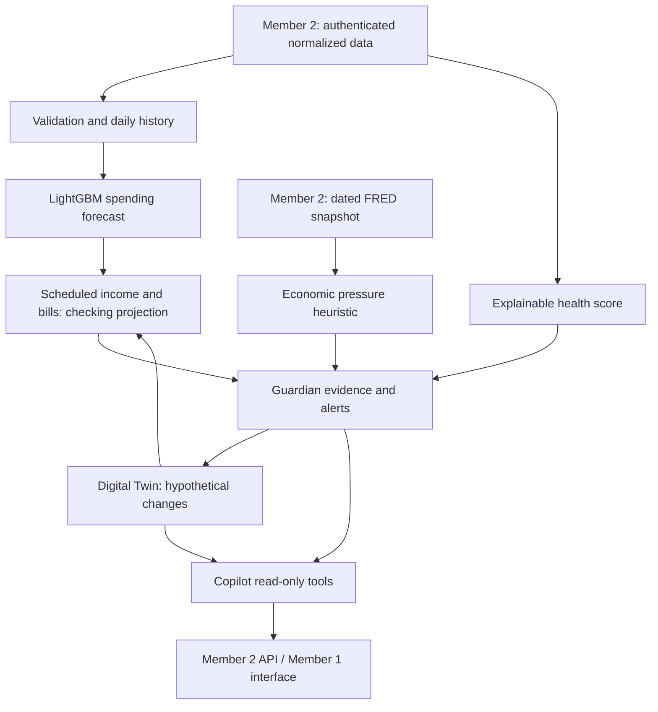

# FinPilot intelligence architecture

Member 3 implements Python functions with JSON-compatible outputs. No frontend, HTTP server, database migration, login or external data ingestion is introduced here.

Training is offline: PNC CSV ledger → exclude transfers/noncash activity → dense daily variable consumption → past-only features → chronological train/validation/test → held-out-customer evaluation → saved model text and report. All six held-out customers are excluded from both fitting and model selection. Rolling features during one-step test evaluation use observed previous test days; recursive backtesting instead uses only the original history and earlier predictions.

Serving is synchronous, on demand and free of database writes. `service.analyze()` calculates health, economy, forecast and Guardian. `simulator.simulate()` deep-copies the inputs and returns before/after results. Savings transfers reduce projected checking while increasing a separate savings path; total liquid assets are conserved. Scores describe current state plus changed monthly assumptions; they are not future-date scores recomputed for every path point.

PNC toolkit review: `wellness/profile.py` consolidates assets and liabilities; `metrics.py` supplies emergency coverage, debt-to-income and savings ratios; `forecast.py` supplies an aggregate monthly baseline; `scenarios.py` demonstrates pure recalculation. FinPilot adopts these calculation patterns while introducing explicit checking schedules, separate savings, five weighted components, daily ML and multi-scenario comparison. The larger ledger adapter is separate because its amounts are positive and its transfers have paired legs, unlike the toolkit's small signed-amount JSON fixture.

API ownership stays with Member 2: authorize the user before constructing inputs; never accept a customer ID selected by the LLM. Frontend integration can begin immediately with `data/synthetic/demo.json`.
